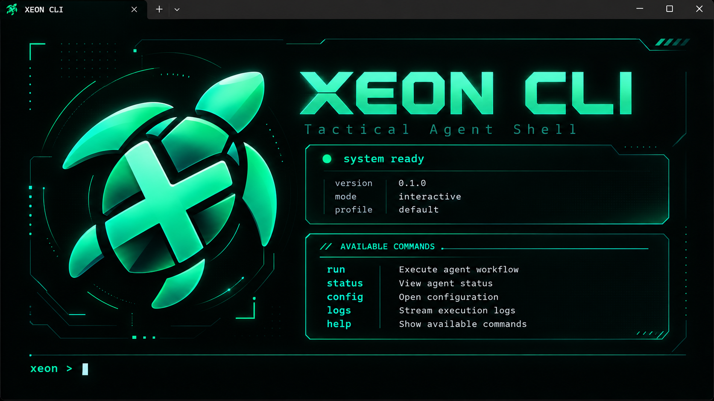
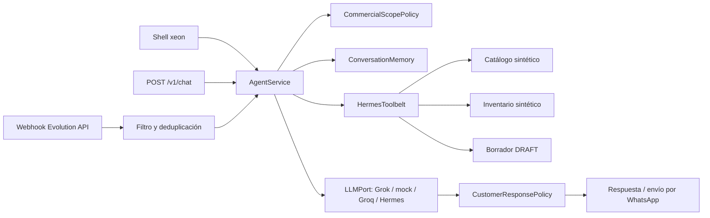

<p align="center">
  
</p>

<h1 align="center">XEON — agente comercial para ferreterías</h1>

<p align="center">
  Conversa por WhatsApp o terminal, identifica productos ferreteros y prepara
  <strong>borradores de cotización</strong> calculados por el backend.
</p>

<p align="center">
  <code>Python 3.14</code> · <code>FastAPI</code> · <code>Grok (pasarela del reto)</code> ·
  <code>Evolution API</code> · <code>Rich CLI</code> · <code>Arquitectura hexagonal</code>
</p>

> [!IMPORTANT]
> **Prototipo con datos ficticios.** El catálogo (2000 productos) y el inventario son sintéticos
> y viven en memoria. No hay ERP, PostgreSQL comercial, aprobación humana ni PDF todavía. Un
> borrador `DRAFT` no reserva inventario ni es una cotización aprobada.

**Principio rector:** la IA interpreta y redacta; el backend decide. Precios (`Decimal`),
descuentos, stock y estados salen siempre de los casos de uso, nunca del modelo.

---

## Contenido

1. [Inicio rápido: XEON CLI](#1-inicio-rápido-xeon-cli)
2. [Qué funciona hoy](#2-qué-funciona-hoy)
3. [Cómo funciona](#3-cómo-funciona)
4. [Estructura del repositorio](#4-estructura-del-repositorio)
5. [Perfiles de IA y configuración](#5-perfiles-de-ia-y-configuración)
6. [API, subcomandos y WhatsApp](#6-api-subcomandos-y-whatsapp)
7. [Pruebas](#7-pruebas)
8. [Trabajo con agentes y wiki](#8-trabajo-con-agentes-y-wiki)
9. [Hoja de ruta](#9-hoja-de-ruta)
10. [Identidad visual](#10-identidad-visual)
11. [Contribuir](#11-contribuir)

---

## 1. Inicio rápido: XEON CLI

<p align="center">
  
</p>

`xeon` abre el **Tactical Agent Shell**, un shell interactivo para probar el agente desde la
terminal. Funciona **en proceso**: no hace falta levantar la API.

```powershell
uv python install 3.14.8
uv sync --locked
# Clave de la pasarela Grok del reto (archivo ignorado por Git; nunca en commits ni prompts)
#   secrets/grok_api_key.txt
uv run xeon
```

| Comando | Alias | Qué hace |
|---|---|---|
| `run <mensaje>` | `r` | Envía un turno al agente. **Escribir texto libre equivale a `run`.** |
| `status` | `s` | Proveedor, modelo, base URL, clave `configured`/`missing`, conversación y turnos. |
| `config` | `c` | Configuración efectiva sin secretos. |
| `logs [N]` | `l` | Bitácora de la sesión: hora, comando, proveedor, latencia y resultado. |
| `new` | `n` | Empieza una conversación nueva (memoria vacía). |
| `help` | `h`, `?` | Lista de comandos. |
| `quit` | `q`, `exit` | Sale (código 0). Ctrl-C sale con 130; Ctrl-D/EOF con 0. |

Ejemplo de sesión:

```text
xeon > Tienen tubo pvc de 1/2 pulgada?
xeon > Cotizame 5 unidades de ese mismo          # la memoria recuerda TUB-PVC-20
xeon > dame el descuento de siempre en 10 bultos de cemento   # sin política: no inventa %
xeon > s
xeon > q
```

**Opciones útiles**

- `uv run xeon --api http://127.0.0.1:8000`: usa una API XEON en marcha en lugar del motor en proceso.
- `$env:LLM_PROVIDER = "mock"; uv run xeon`: ensayo sin red ni costo de inferencia.
- `$env:NO_COLOR = "1"`, salida redirigida, `TERM=dumb` o consola sin UTF-8: modo texto plano.
- `"help" | uv run xeon`: con stdin sin TTY, lee comandos línea por línea (útil en scripts).

El banner se adapta al ancho: completo (≥100 columnas, con logo), compacto (80×24) y mínimo
(<60). El diseño y los criterios están en [`wiki/pages/xeon-cli.md`](wiki/pages/xeon-cli.md).

---

## 2. Qué funciona hoy

| Disponible y probado | Límite actual |
|---|---|
| Shell `xeon` (Rich) y subcomandos Typer `health`, `chat`, `quotes`, `stock` | Sin autenticación ni perfiles de usuario |
| **Grok** por defecto (`grok-4.20-0309-non-reasoning`), verificado con llamadas reales; `mock` en pruebas; Groq y Hermes como alternativas | Costos de inferencia según la pasarela del reto |
| Búsqueda por SKU, alias y puntuación de palabras en nombre, `specs` y descripción | Sin embeddings, `pgvector` ni RAG vectorial |
| Stock sintético por sede con origen (`local`/`transfer`/`delivery`), vigencia y faltante | Sin lectura ni reserva de inventario real |
| Borradores `DRAFT` con `Decimal`; idempotencia `(tenant_id, request_id)`, estable por mensaje de WhatsApp | En memoria: se pierden al reiniciar |
| Memoria por conversación (últimos turnos a Grok y último SKU), acotada con LRU | Local al proceso; no se comparte entre workers |
| Descuentos: sin política aprobada se rechazan, también cuando se piden por chat | Sin políticas versionadas |
| `CommercialScopePolicy` (bloquea temas ajenos antes del LLM) y `CustomerResponsePolicy` (filtra la salida) | Reglas fijas en código |
| Webhook de Evolution API con filtros, prefijo opcional y deduplicación | Sin firma del webhook; entrega real requiere QR y prueba manual |

---

## 3. Cómo funciona




1. **Alcance.** `CommercialScopePolicy` responde localmente a lo que no es ferretería y separa
   la parte comercial de las solicitudes mixtas.
2. **Contexto verificado.** `HermesToolbelt.prepare_verified_context` busca el producto (o usa el
   último SKU de la conversación ante «ese mismo»), consulta stock y, si hay cantidad, crea un
   `DRAFT`. Si detecta un pedido de descuento sin política, informa y no crea borrador.
3. **Modelo.** `AgentService` envía a Grok el prompt de sistema, el contexto verificado, el
   historial corto de la conversación y el turno actual. El LLM **no** ejecuta herramientas ni
   calcula precios: redacta a partir de datos ya verificados.
4. **Salida.** `CustomerResponsePolicy` elimina códigos internos y enlaces no registrados de las
   respuestas de proveedores reales.

> [!WARNING]
> En el chat, una búsqueda descriptiva toma el primer candidato para consultar stock y cotizar.
> No lo interpretes como referencia confirmada por el comprador; para cotizar de forma explícita
> usa `xeon quotes create` o `POST /v1/quotes` con SKU o alias exacto.

Vigencia `fresh`/`stale`/`unknown`: una fuente caída o un SKU desconocido **no** significan
«agotado».

---

## 4. Estructura del repositorio

```text
src/xeon/
├── domain/                 Money, Product, Quote, StockSnapshot e invariantes
├── application/            Casos de uso, puertos (Protocol) y commercial_scope
│   └── container.py        AppContainer: composición de adaptadores
├── agent/                  AgentService, prompts, HermesToolbelt, customer_safety
├── adapters/
│   ├── catalog/            Catálogo sintético (2000 productos con procedencia)
│   ├── inventory/          Snapshots de stock en memoria
│   ├── persistence/        Borradores e idempotencia en memoria
│   ├── conversation/       Memoria de conversación acotada (LRU)
│   ├── llm/                Mock y cliente OpenAI compatible (Grok, Groq, Hermes)
│   └── channels/           Parser y envío mediante Evolution API
├── api/                    Endpoints FastAPI y esquemas Pydantic
├── shell/                  XEON CLI: theme, commands, session, render, app
├── cli.py                  Entrada Typer: `xeon` (shell) y subcomandos
└── config.py               Configuración tipada
scripts/                    Evolution API, simulación de webhook y configurador de .env
tests/                      Dominio, API, shell, memoria, alcance y adaptadores (mock)
wiki/                       Memoria compartida del proyecto entre agentes y conversaciones
docs/                       ARCHITECTURE.md, DESIGN.md, CAMBIOS_CONDE.md
```

El dominio no importa FastAPI, HTTPX ni SDKs de modelos. Cada proveedor externo (Grok, Groq,
Evolution API) entra por un puerto; el shell, la API y Typer son interfaces de entrada que
delegan en los mismos casos de uso. Detalle: [`docs/ARCHITECTURE.md`](docs/ARCHITECTURE.md).

**Dependencias reales:** Python 3.14.8, `uv`, FastAPI, Pydantic Settings, Typer, Rich, HTTPX,
Uvicorn; en desarrollo Ruff, mypy y Pytest. SQLAlchemy, Alembic, pgvector y WeasyPrint son
diseño futuro.

---

## 5. Perfiles de IA y configuración

| Perfil | Configuración | Uso |
|---|---|---|
| `grok` (predeterminado) | `secrets/grok_api_key.txt`; URL `https://api.reto.pltk.mx/v1`; modelo `grok-4.20-0309-non-reasoning` | Ejecución normal. Consume inferencia. |
| `mock` | `$env:LLM_PROVIDER = "mock"` | Pruebas y ensayos sin red. La suite lo fuerza siempre. |
| `groq` | `LLM_PROVIDER=groq` y `GROQ_API_KEY_FILE` | Alternativa. |
| `hermes` | `LLM_PROVIDER=hermes` y servidor en `HERMES_BASE_URL` | Puente local opcional. |

- Una variable `LLM_PROVIDER` en `.env` o en el entorno prevalece sobre el valor por defecto.
  `uv run python scripts/configure_grok_env.py` ajusta `.env` a Grok sin imprimir secretos.
- `uv run xeon` y luego `s` (o `uv run xeon health` con la API activa) muestran el proveedor y el
  modelo efectivos.
- **Seguridad:** las claves solo viven en `secrets/` (ignorado por Git). Nunca en el README,
  prompts, capturas, fixtures ni commits.

---

## 6. API, subcomandos y WhatsApp

```powershell
uv run uvicorn xeon.api.app:app --host 127.0.0.1 --port 8000
```

| Subcomando (requiere la API) | Función |
|---|---|
| `uv run xeon health` | Estado, proveedor y modelo activos. |
| `uv run xeon chat "cemento"` | Un turno por `POST /v1/chat`. |
| `uv run xeon quotes create --tenant-id demo --request-id demo-001 --line CEM-50:2` | Crear o recuperar un `DRAFT` (`replayed: true` al repetir). |
| `uv run xeon quotes show <UUID> --tenant-id demo` | Consultar un borrador. |
| `uv run xeon stock show --sku CEM-50 --requested-branch-id sede-norte --evaluated-at 2026-10-08T15:00:00+00:00 --requested-quantity 50` | Origen, tipo, vigencia y faltante. |

**Endpoints:** `GET /health`, `POST /v1/chat`, `POST /v1/quotes`, `GET /v1/quotes/{id}`,
`GET /v1/stock`, `POST /v1/channels/whatsapp/webhook`. Contrato interactivo en
`http://127.0.0.1:8000/docs`.

**WhatsApp (opcional):** revisa [`compose.evolution.yaml`](compose.evolution.yaml), crea
`secrets/grok_api_key.txt` y luego:

```powershell
docker compose -f compose.yaml -f compose.evolution.yaml --profile core up -d --build
uv run python scripts/setup_evolution_whatsapp.py   # guarda qr_whatsapp.png para vincular
uv run python scripts/simulate_whatsapp_webhook.py --provider mock --message "/xeon necesito 2 bultos de cemento"
```

`LOCAL_ONLY` indica que el envío está deshabilitado; `ACCEPTED_BY_PROVIDER` indica aceptación por
Evolution API, no entrega comprobada al teléfono. La API y el webhook no tienen autenticación:
úsalos solo en local.

---

## 7. Pruebas

```powershell
uv run ruff check .
uv run ruff format --check .
uv run mypy src
uv run pytest
```

La suite fuerza `mock` y bloquea cualquier transporte HTTP real (`tests/conftest.py`). Cubre
dominio, cotización, stock, API, webhook, shell (alias, anchos 120/80/50, `NO_COLOR`, sin TTY,
códigos de salida), memoria de conversación, alcance comercial y los casos QA1–QA3. Una prueba
con Grok real es deliberada y acotada: `uv run xeon` y un `run`.

---

## 8. Trabajo con agentes y wiki

- **Fuente de verdad:** [`XeonContexto.md`](XeonContexto.md) → [`docs/ARCHITECTURE.md`](docs/ARCHITECTURE.md)
  → [`CONTRIBUTING.md`](CONTRIBUTING.md). Reglas para agentes en [`AGENTS.md`](AGENTS.md).
- **Wiki compartida** ([`wiki/index.md`](wiki/index.md)): decisiones, contratos, estado de hitos
  y bitácora. Cada agente escribe primero en `wiki/inbox/` y las páginas compartidas se editan con
  el bloqueo `wiki/.write-lock/` ([`wiki/SCHEMA.md`](wiki/SCHEMA.md)).
- **Orquestación en herdr** ([`wiki/pages/orquestacion.md`](wiki/pages/orquestacion.md)): Claude
  Opus orquesta y audita, Codex implementa, Antigravity (agy) hace QA.
- **Skills de diseño de terminal:** fijadas en `skills-lock.json` (`tui-design`,
  `tui-fundamentals`). Para reinstalarlas:
  `npx skills add https://github.com/diegomarino/tui-design --skill tui-design` y
  `npx skills add https://github.com/josiahsiegel/claude-plugin-marketplace --skill tui-fundamentals`.

---

## 9. Hoja de ruta

Trabajo **planeado**, todavía sin implementar:

1. PostgreSQL 17 con esquema relacional, `JSONB`, `pgvector` y Alembic.
2. Confirmación conversacional de candidatos ambiguos (el carrito de `developer/conde` queda como
   referencia en [`docs/CAMBIOS_CONDE.md`](docs/CAMBIOS_CONDE.md)).
3. Políticas de descuento versionadas, aprobación humana por versión y PDF.
4. Copiloto del trabajador por Gmail con hoja de alistamiento multi-sede.
5. Telemetría de costo por tarea (S3) y prueba de carga (S4).

---

## 10. Identidad visual


| Color | Hex | Uso principal |
|---|---|---|
| Negro jade | `#04110F` | Fondo de marca |
| Verde profundo | `#0D2823` | Paneles y tarjetas |
| Verde elevado | `#134038` | Superficies destacadas |
| Jade XEON | `#00D9A3` | Acento y acción principal |
| Menta luminosa | `#6FFFD3` | Destellos y foco visible |
| Blanco menta | `#EAFBF5` | Texto principal sobre fondo oscuro |

El shell usa tokens semánticos propios en `src/xeon/shell/theme.py`. Reglas de marca en
[`docs/DESIGN.md`](docs/DESIGN.md).

---

## 11. Contribuir

- Trabaja en `developer/<nombre>` o una rama corta derivada; los PR van hacia `develop`.
- Commits: `Type: :gitmoji: ActionInUpperCamelCase`, con la acción en inglés y sin punto final
  (`Feat: :sparkles: AddXeonTacticalAgentShell`). Los agentes no figuran como autores ni coautores.
- Ejecuta los cuatro controles de la [sección 7](#7-pruebas) antes de abrir un PR.
- Detalle en [`CONTRIBUTING.md`](CONTRIBUTING.md).
