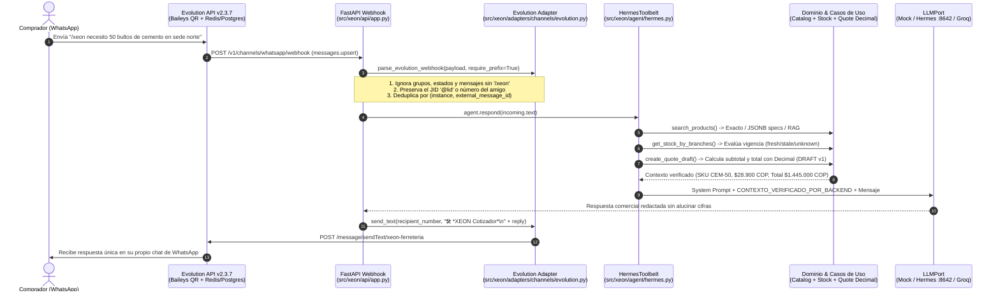

# XEON — Agente Comercial y Cotizador Determinista para Ferreterías

XEON es un asistente comercial e infraestructura de cotización para ferreterías, agroferreterías y distribuidores descrito en [`XeonContexto.md`](XeonContexto.md). Combina conversación natural en **WhatsApp (Evolution API a costo \$0)** y orquestación con **Hermes / Groq API** con un **núcleo transaccional determinista en Python (`Decimal`)** y un modelo de datos híbrido (**SQL Relacional + NoSQL `JSONB` + RAG Semántico**).

> [!IMPORTANT]
> **Regla de oro de arquitectura:** La IA (`Hermes` / `Groq`) interpreta el lenguaje coloquial del cliente y propone candidatos mediante búsqueda híbrida (`RAG` + `specs JSONB`), pero **jamás calcula precios, ni otorga descuentos libres, ni modifica inventario, ni aprueba cotizaciones**. Todo cálculo monetario (`Decimal`), disponibilidad por sede (`fresh` / `stale` / `unknown`) y creación de borradores (`DRAFT`) ocurre de forma determinista en el backend.

---

## Tabla de Contenidos

1. [Orden de Lectura Obligatorio (Fuente de Verdad)](#1-orden-de-lectura-obligatorio-fuente-de-verdad)
2. [Flujo de Trabajo del Proyecto (De Punta a Punta)](#2-flujo-de-trabajo-del-proyecto-de-punta-a-punta)
3. [Estructura del Repositorio y Fronteras Hexagonales](#3-estructura-del-repositorio-y-fronteras-hexagonales)
4. [Guía para el Siguiente Desarrollador (Instalación desde Cero)](#4-guía-para-el-siguiente-desarrollador-instalación-desde-cero)
5. [Cómo Testear Todas las Funcionalidades (4 Niveles de Prueba)](#5-cómo-testear-todas-las-funcionalidades-4-niveles-de-prueba)
6. [Herramienta CLI Actual (`uv run xeon`)](#6-herramienta-cli-actual-uv-run-xeon)
7. [Ideas de Evolución: Futura CLI y Flujo Copiloto con Gmail (Post-MVP)](#7-ideas-de-evolución-futura-cli-y-flujo-copiloto-con-gmail-post-mvp)
8. [Estado del Corte Actual](#8-estado-del-corte-actual)

---

## 1. Orden de Lectura Obligatorio (Fuente de Verdad)

Antes de modificar código o proponer nuevas funciones, cualquier desarrollador o agente debe leer estos documentos en orden:

| Orden | Documento | Qué define |
|---|---|---|
| **1** | [`XeonContexto.md`](XeonContexto.md) | Problema de negocio, alcance del MVP vs. Post-MVP, 12 principios obligatorios y diseño de Base de Datos Híbrida (`SQL + JSONB + pgvector`). |
| **2** | [`docs/ARCHITECTURE.md`](docs/ARCHITECTURE.md) | Fronteras hexagonales implementadas, casos de verificación (`T01`–`T19`) y elementos pendientes. |
| **3** | [`CONTRIBUTING.md`](CONTRIBUTING.md) | Flujo de ramas (`developer/<nombre>`), controles de calidad y formato obligatorio de commits. |
| **4** | [`AGENTS.md`](AGENTS.md) | Reglas de seguridad, prohibición de exponer secretos y límites estrictos para asistentes de IA. |
| **5** | [`GLOSSARY.md`](GLOSSARY.md) | Lenguaje ubicuo del dominio (`Money`, `Product`, `Quote`, `Draft`, `IdempotencyKey`, `ClarificationRequired`). |
| **6** | [`docs/index.md`](docs/index.md) | Portada navegable cuando se abre la raíz del repositorio como bóveda de **Obsidian**. |

Si encuentras una diferencia entre el código y [`XeonContexto.md`](XeonContexto.md), detente, documenta la diferencia y acuerda una decisión explícita. **Nunca presentes una capacidad planeada como ya implementada.**

---

## 2. Flujo de Trabajo del Proyecto (De Punta a Punta)

Cuando un comprador o contacto envía un mensaje por WhatsApp, el sistema ejecuta **6 etapas deterministas y auditables**:



### Detalle de cada etapa del flujo

1. **Recepción y Cifrado Signal E2EE (`compose.evolution.yaml`):**
   - `evoapicloud/evolution-api:latest` (`v2.3.7`) mantiene la sesión vinculada por QR usando PostgreSQL (`DATABASE_SAVE_DATA_NEW_MESSAGE=true` para reintentos de descifrado Signal en iPhone/Android) y Redis.
2. **Cortafuegos de Privacidad y Enrutamiento (`src/xeon/adapters/channels/evolution.py`):**
   - Con `WHATSAPP_REQUIRE_PREFIX=true`, **solo** los mensajes que inician con `/xeon` o `#xeon` activan el bot. Tus conversaciones personales normales devuelven `status="ignored"` en menos de 1 ms y nunca llegan al modelo.
   - Si un amigo te escribe desde un identificador de privacidad de WhatsApp (`<id>@lid`), `_normalize_number()` conserva el sufijo `@lid` y nunca lo reemplaza por `payload["sender"]` (que en Evolution API corresponde al dueño de la instancia), garantizando que la respuesta llegue al chat de tu amigo.
   - `whatsapp_webhook` en [`src/xeon/api/app.py`](src/xeon/api/app.py) mantiene un registro en memoria `seen_webhook_messages` por `(instance, external_message_id)` para bloquear cualquier webhook duplicado.
3. **Ejecución de Herramientas Deterministas (`src/xeon/agent/hermes.py`):**
   - Antes de invocar al LLM, `HermesToolbelt.format_verified_context()` ejecuta:
     - `search_products`: busca coincidencia exacta por SKU/alias, o recupera candidatos por atributos técnicos polimórficos (`Product.specs` `JSONB`) y contexto semántico (`Product.description_context` `RAG`). Si faltan unidades (ej. `20 x 30 x 10`) o la referencia es ambigua (*«el coso del aire»*), exige aclaración (`ClarificationRequired`).
     - `get_stock_by_branches`: consulta disponibilidad local, faltante (`shortfall`) y alternativas en otras sedes (`Sede Norte`, `Sede Centro`, `Sede Sur`), clasificando cada snapshot como `fresh`, `stale` o `unknown`.
     - `create_quote_draft`: si el cliente indicó cantidad, construye un borrador idempotente en estado `DRAFT` (`version=1`) usando exclusivamente aritmética `Decimal`.
4. **Síntesis Conversacional Acotada (`src/xeon/agent/service.py` + `LLMPort`):**
   - El modelo (`mock`, `hermes` en `:8642/v1` con `SOUL.md` y skill `xeon-cotizador`, o `groq`) recibe el bloque `[HERMES_TOOL:...]` como hechos verificados de sistema y redacta la respuesta para el comprador.
5. **Despacho con Cabecera Anti-Bucle:**
   - La respuesta se envía precedida por `🛠️ *XEON Cotizador*`. Si Evolution API emite un eco del mensaje saliente, el filtro detecta esta cabecera y lo ignora automáticamente.

---

## 3. Estructura del Repositorio y Fronteras Hexagonales

```text
xeon/
├── src/xeon/
│   ├── domain/                  # Núcleo puro (CERO imports de FastAPI, HTTPX o SDKs)
│   │   ├── money.py             # Value Object Money con Decimal y redondeo comercial
│   │   ├── product.py           # Product con specs polimórficos y contexto RAG
│   │   ├── inventory.py         # StockSnapshot, Freshness (fresh/stale/unknown), Fulfillment
│   │   └── quote.py             # Quote, QuoteLine, QuoteStatus.DRAFT e invariantes
│   ├── application/             # Casos de uso y Puertos (Protocols)
│   │   ├── ports/               # catalog.py, inventory.py, quotes.py, llm.py, channels.py
│   │   ├── quote_draft.py       # CreateQuoteDraft, GetQuoteDraft, clasificación de errores
│   │   ├── quote_request.py     # Detección de medidas sin unidades y referencias ambiguas
│   │   ├── stock.py             # GetStockByBranches y cálculo de faltante local
│   │   └── container.py         # AppContainer (Composition Root)
│   ├── agent/                   # Orquestación Hermes
│   │   ├── hermes.py            # HermesToolbelt y format_verified_context
│   │   └── service.py           # AgentService y System Prompt blindado
│   ├── adapters/                # Implementaciones concretas de infraestructura
│   │   ├── catalog/memory.py    # Catálogo híbrido en memoria (SQL + specs + RAG)
│   │   ├── inventory/memory.py  # Snapshots sintéticos multi-sede con vigencias reales
│   │   ├── persistence/memory.py# Repositorio idempotente (tenant_id + request_id)
│   │   ├── llm/                 # MockLLM, OpenAICompatibleLLMAdapter (Hermes y Groq)
│   │   └── channels/evolution.py# Webhook parser (@lid, /xeon) y cliente sendText
│   ├── api/                     # Capa HTTP REST (FastAPI)
│   │   ├── app.py               # Endpoints /health, /v1/chat, /v1/quotes, /v1/stock, webhook
│   │   └── schemas.py           # Contratos Pydantic v2 de entrada/salida
│   ├── cli.py                   # Herramienta CLI en Typer (uv run xeon ...)
│   └── config.py                # Settings tipados y lectura segura de *_FILE
├── scripts/
│   ├── setup_evolution_whatsapp.py   # Aprovisiona instancia y genera qr_whatsapp.png
│   └── simulate_whatsapp_webhook.py  # Simulador local de webhook sin requerir celular
├── tests/                       # Suite completa Pytest (dominio, casos T01-T19, canales, CLI)
├── compose.yaml                 # Servicio core de la API de XEON
├── compose.evolution.yaml       # Stack WhatsApp $0 (Evolution API v2.3.7 + Postgres + Redis)
└── compose.groq.yaml            # Override para montar secret de Groq en contenedor
```

---

## 4. Guía para el Siguiente Desarrollador (Instalación desde Cero)

### 4.1. Requisitos previos
- **Python `3.14.8`** (administrado automáticamente por `uv`).
- **[`uv`](https://docs.astral.sh/uv/)** instalado en el sistema.
- **Docker Desktop** (con Docker Compose v2) para levantar el stack de WhatsApp / Evolution API.
- *(Opcional)* **Hermes Agent CLI** si vas a probar el puente local `LLM_PROVIDER=hermes` en el puerto `8642`.

### 4.2. Clonar, verificar rama e instalar entorno

Ejecuta en **PowerShell** desde la raíz del proyecto:

```powershell
# 1. Comprobar que estás en tu rama de desarrollador (NUNCA trabajar directo en main)
git status
git branch --show-current
# Si necesitas crear tu rama: git checkout -b developer/tu_nombre

# 2. Instalar Python 3.14.8 y sincronizar el entorno bloqueado (uv.lock)
uv python install 3.14.8
uv sync --locked
```

### 4.3. Reglas de seguridad y commits antes de escribir código

1. **Cero secretos expuestos:** Nunca leas, imprimas ni versiones `secrets/groq_api_key.txt`, `secrets/evolution_api_key.txt` ni archivos `.env`. Usa `.env.example` como plantilla de referencia.
2. **Formato obligatorio de commits** (validado automáticamente por `.git/hooks/commit-msg`):
   ```text
   type: :emoji: ActionInUpperCamelCase
   ```
   Ejemplos válidos:
   - `feat: :sparkles: AddStockPickingCommand`
   - `fix: :bug: HandleMissingBranchSnapshot`
   - `docs: :memo: UpdateDeveloperOnboardingGuide`
   - `test: :test_tube: CoverAmbiguousProductSearch`

---

## 5. Cómo Testear Todas las Funcionalidades (4 Niveles de Prueba)

### Nivel 1: Suite Automatizada y Calidad de Código (Obligatorio en cada cambio)

Antes de hacer cualquier commit, estos 4 comandos deben pasar en verde:

```powershell
uv run ruff check .
uv run ruff format --check .
uv run mypy src
uv run pytest -v
```

La suite ejecuta **80 pruebas automatizadas** en ~1.5 segundos (con `LLM_PROVIDER=mock`, sin realizar llamadas de red ni gastar saldo de API), cubriendo los casos `T01` a `T19` de [`XeonContexto.md`](XeonContexto.md).

---

### Nivel 2: Pruebas Locales en Modo `mock` (Costo \$0, sin Docker ni Internet)

Ideal para desarrollar lógica de dominio, catálogo, inventario o endpoints HTTP:

**Terminal 1 — Levantar el servidor FastAPI:**
```powershell
$env:LLM_PROVIDER = "mock"
uv run uvicorn xeon.api.app:app --reload --host 127.0.0.1 --port 8000
```

**Terminal 2 — Probar cada caso de uso comercial:**

```powershell
# 1. Salud del servicio
uv run xeon health

# 2. Búsqueda híbrida por contexto semántico (RAG) y especificaciones técnicas (JSONB)
uv run xeon chat "busco material para fundir placa y pegar ladrillo"
uv run xeon chat "necesito tuberia para agua fria de 200 psi"
uv run xeon chat "alambre para cercar ganado en un potrero"

# 3. Reglas de desambiguación (Casos T02 y T03: exige aclaración, no inventa SKUs)
uv run xeon chat "necesito el coso que va en el aire acondicionado"
uv run xeon chat "la pieza mide 20 x 30 x 10"

# 4. Simular un mensaje entrante de WhatsApp sin necesidad de levantar Evolution API
uv run python scripts/simulate_whatsapp_webhook.py --provider mock --text "/xeon necesito 50 bultos de cemento"
```

---

### Nivel 3: Pruebas con el Puente Local de Hermes (`LLM_PROVIDER=hermes`)

XEON se conecta al servidor OpenAI-compatible de **Hermes** (`http://127.0.0.1:8642/v1`). Esto permite usar la personalidad configurada en `SOUL.md`, la skill `xeon-cotizador` y cambiar el modelo subyacente en Hermes sin tocar el código de XEON.

```powershell
# Terminal 1: Iniciar el gateway local de Hermes (expone http://0.0.0.0:8642/v1)
hermes gateway run --replace

# Terminal 2: Probar el flujo de extremo a extremo contra Hermes
$env:LLM_PROVIDER = "hermes"
uv run python scripts/simulate_whatsapp_webhook.py --provider hermes --text "/xeon necesito 50 bultos de cemento en sede norte"
```

---

### Nivel 4: Prueba Real en WhatsApp con Evolution API (`compose.evolution.yaml`)

Levanta el entorno completo en Docker (`xeon-api`, `evolution-api v2.3.7`, `postgres:17-alpine` y `redis:7-alpine`):

```powershell
# 1. Asegurarte de que 'hermes gateway run' esté activo en tu máquina host (puerto 8642)

# 2. Levantar los 4 contenedores de Docker
docker compose --profile core -f compose.yaml -f compose.evolution.yaml up -d --build

# 3. Aprovisionar la instancia 'xeon-ferreteria', configurar el webhook y generar el QR
uv run python scripts/setup_evolution_whatsapp.py
```

- **Vincular celular:** Abre `qr_whatsapp.png` en la raíz del proyecto (o entra a `http://127.0.0.1:8080/manager` con API Key `xeon-evolution-local-key`) y escanéalo desde tu WhatsApp (*Configuración → Dispositivos vinculados → Vincular un dispositivo*).
- **Cómo probar desde WhatsApp:**
  - **Desde tu propio celular (chat contigo mismo "Tú"):** Escribe `/xeon necesito 50 bultos de cemento`.
  - **Desde el celular de un amigo:** Pídele que te escriba `/xeon quiero comprar cemento`. El bot le responderá **únicamente en el chat de tu amigo** y una sola vez.
  - **Tus chats personales están protegidos:** Cualquier mensaje que **no** empiece con `/xeon` o `#xeon` es ignorado por completo (`WHATSAPP_REQUIRE_PREFIX=true`).

**Comandos útiles de diagnóstico en vivo:**
```powershell
# Ver estado de conexión de WhatsApp ("state": "open")
Invoke-RestMethod -Uri "http://127.0.0.1:8080/instance/connectionState/xeon-ferreteria" -Headers @{ apikey = "xeon-evolution-local-key" }

# Ver logs de la API de XEON y de Evolution API
docker logs --tail 50 xeon-api-1
docker logs --tail 50 xeon-evolution-api-1
```

---

## 6. Herramienta CLI Actual (`uv run xeon`)

El proyecto incluye una herramienta de línea de comandos construida con **Typer** en [`src/xeon/cli.py`](src/xeon/cli.py) para operar y auditar el backend sin necesidad de interfaz web.

*(Requiere tener la API corriendo en `http://127.0.0.1:8000` o pasar `--base-url`).*

| Comando CLI | Propósito | Ejemplo de ejecución |
|---|---|---|
| `xeon health` | Verifica estado de la API, entorno y proveedor LLM activo. | `uv run xeon health` |
| `xeon chat "<texto>"` | Envía una consulta al agente comercial (`POST /v1/chat`). | `uv run xeon chat "cemento gris 50kg"` |
| `xeon quotes create` | Crea o recupera de forma idempotente (`tenant_id + request_id`) un borrador `DRAFT` calculado con `Decimal`. | `uv run xeon quotes create --tenant-id demo --request-id req-01 --line CEM-50:50 --line ALA-14:10` |
| `xeon quotes show` | Consulta el detalle y líneas de un borrador por su `UUID` y `tenant_id`. | `uv run xeon quotes show <UUID> --tenant-id demo` |
| `xeon stock show` | Evalúa disponibilidad por sede, vigencia (`fresh`/`stale`/`unknown`), faltante local y alternativas en otras sedes. | `uv run xeon stock show --sku CEM-50 --requested-branch-id sede-norte --requested-quantity 50 --evaluated-at 2026-10-08T15:00:00+00:00` |

### Ejemplo de respuesta de `xeon stock show` (Caso `T05` — Faltante local con alternativas):

```powershell
uv run xeon stock show `
  --sku CEM-50 `
  --requested-branch-id sede-norte `
  --requested-quantity 50 `
  --evaluated-at 2026-10-08T15:00:00+00:00
```
- **Qué devuelve:** Muestra que `sede-norte` tiene `20` bultos firmes (`fresh`), calcula un faltante (`shortfall`) de `30` bultos (`fulfillment_status: "partial"`), y lista las alternativas verificadas: `80` bultos en `sede-centro` (traslado) y `40` en canal de entrega, advirtiendo además si algún registro está vencido (`stale`, como `sede-sur`).

---

## 7. Ideas de Evolución: Futura CLI y Flujo Copiloto con Gmail (Post-MVP)

> [!NOTE]
> **Importante:** Todo lo descrito en esta sección son **ideas de diseño y evolución post-MVP (aún NO implementadas en el código)**, pensadas para que el siguiente desarrollador expanda XEON bajo la filosofía de **optimizar el tiempo del trabajador humano en lugar de reemplazarlo**.

### 7.1. Idea de Negocio Central: Pre-Facturación y Confirmación del Trabajador por Gmail

En una ferretería real, el vendedor de mostrador pierde la mayor parte del día traduciendo mensajes de WhatsApp a códigos `SKU`, llamando a otras bodegas y digitando pre-facturas. El flujo post-MVP propuesto convierte a XEON en el copiloto del vendedor:

1. **Cierre del borrador con el cliente en el Harness:** Cuando el cliente define productos, cantidades, sede y términos comerciales (incluyendo descuentos por volumen pre-autorizados en el *harness* del backend), la cotización pasa de `DRAFT` a `PENDING_APPROVAL`.
2. **Notificación por Gmail al trabajador (`WorkerNotificationPort` / SMTP):** XEON envía automáticamente un correo electrónico estructurado al Gmail del vendedor/facturador con:
   - **Tabla lista para facturar en POS:** `SKU`, descripción, unidad, cantidad, precio de lista, descuento aplicado por política del *harness* y total en `Decimal`.
   - **Semáforo de Descuentos:** indica en verde si el descuento está dentro de la política automática por volumen, o en amarillo (`⚠️ Requiere Autorización`) si el cliente solicitó una condición especial.
   - **Hoja de Alistamiento Multi-Sede (*Picking / Split-Order*):** indica exactamente cuántas unidades despachar de la sede local y cuántas solicitar por traslado desde otra sucursal.
3. **Confirmación Humana para Facturar:** El trabajador revisa el correo y aprueba con un clic (o desde la CLI). El backend valida que la versión (`version`) no haya cambiado, pasa la cotización a `APPROVED_FOR_BILLING` y **le avisa automáticamente por WhatsApp al cliente** que su cotización fue autorizada para pasar a caja/facturación.

### 7.2. Ideas de Nuevos Comandos CLI para Implementar (`src/xeon/cli.py`)

El siguiente desarrollador puede extender [`src/xeon/cli.py`](src/xeon/cli.py) con estos comandos pensados para el trabajo diario en mostrador y para diagnóstico técnico:

| Comando CLI Propuesto (Idea) | Problema que resuelve | Cómo funcionaría |
|---|---|---|
| `uv run xeon quotes inbox` | El vendedor no sabe qué cotizaciones se han generado por WhatsApp sin revisar el celular. | Muestra en terminal una tabla interactiva (con `Rich`) de todos los borradores `DRAFT` / `PENDING_APPROVAL` recientes con cliente, total, sede y estado de stock. |
| `uv run xeon quotes notify-worker <quote_id>` | Enviar el borrador listo al correo del facturador o supervisor. | Dispara el correo **Gmail (SMTP)** al trabajador con la pre-factura, los términos del *harness* y la hoja de alistamiento por sede. |
| `uv run xeon quotes approve <quote_id> --by <vendedor>` | Aprobar desde terminal sin usar navegador y avisar al comprador. | Verifica `(quote_id, version)`, cambia el estado a `APPROVED_FOR_BILLING`, genera el PDF oficial y envía el mensaje de confirmación al WhatsApp del cliente. |
| `uv run xeon stock picking <quote_id>` | Coordinar despachos cuando una sola sede no tiene todo el stock. | Cruza todas las líneas del borrador contra `GetStockByBranches` y genera el plan óptimo de despacho (*ej. 20 unds retiro en Sede Norte + 30 unds traslado desde Sede Centro*). |
| `uv run xeon catalog explain "<consulta>"` | Afinar el buscador híbrido cuando un término ferretero regional no encuentra el SKU. | Muestra para una frase de prueba el puntaje de coincidencia exacta, qué atributos `JSONB` (`specs`) hicieron match y qué candidatos devolvió el contexto semántico (`RAG`). |
| `uv run xeon doctor` | Facilitar el onboarding de nuevos desarrolladores del equipo. | Verifica en un solo comando: versión de Python (`3.14.8`), estado de `xeon-api` (`:8000`), conexión con Hermes Gateway (`:8642`) y estado de la sesión QR de WhatsApp en Evolution API (`:8080`). |

---

## 8. Estado del Corte Actual

### ✅ Implementado y verificado (80 tests en verde)
- Dominio comercial con `Money` (`Decimal`), `Product` (`specs` polimórficos + `description_context`), `StockSnapshot` (`fresh` / `stale` / `unknown`) y `Quote` (`DRAFT` v1).
- Casos de uso deterministas: `CreateQuoteDraft` (con idempotencia `tenant_id + request_id`), `GetQuoteDraft` y `GetStockByBranches` (con cálculo de faltante local y alternativas).
- Orquestador `HermesToolbelt` con búsqueda híbrida (exacta + `JSONB` `specs` + `RAG` semántico) e inyección automática de stock y borrador en `format_verified_context`.
- Adaptadores LLM para perfiles `mock` (predeterminado seguro), `hermes` (puente local `:8642/v1` con `SOUL.md` y skill `xeon-cotizador`) y `groq` (`llama-3.3-70b-versatile`).
- Canal WhatsApp costo \$0 con **Evolution API (`v2.3.7` Baileys QR)** en Docker Compose (`compose.evolution.yaml`), filtro de privacidad `/xeon` (`WHATSAPP_REQUIRE_PREFIX=true`), enrutamiento `@lid` al chat del remitente y deduplicación de `external_message_id`.
- API HTTP en FastAPI (`/health`, `/v1/chat`, `/v1/quotes`, `/v1/stock`, `/v1/channels/whatsapp/webhook`) y CLI operativa en Typer (`uv run xeon`).

### ⏳ Pendiente (No implementado aún)
- Persistencia en PostgreSQL 17 (`SQL + JSONB + pgvector`) con migraciones Alembic para los repositorios de dominio.
- Generación de cotización en PDF con WeasyPrint y política de descuentos versionada en base de datos.
- Flujo post-MVP de confirmación por Gmail al trabajador (`WorkerNotificationPort`) y comandos extendidos de la CLI.
