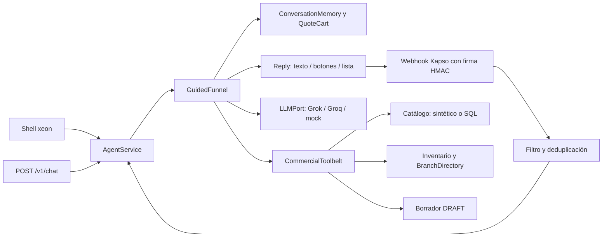
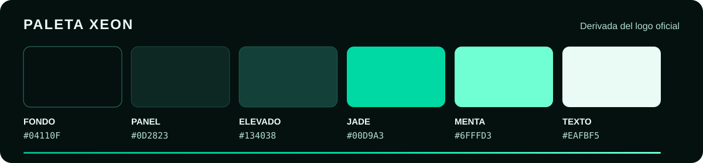

<p align="center">
  
</p>

<h1 align="center">XEON — agente comercial para ferreterías</h1>

<p align="center">
  Conversa por WhatsApp o terminal, identifica productos ferreteros y prepara
  <strong>borradores de cotización</strong> calculados por el backend.
</p>

<p align="center">
  <code>Python 3.14</code> · <code>FastAPI</code> · <code>Grok (pasarela del reto)</code> ·
  <code>Kapso</code> · <code>Rich CLI</code> · <code>Arquitectura hexagonal</code>
</p>

> [!IMPORTANT]
> **Prototipo con datos ficticios.** Por defecto (`DATA_SOURCE=synthetic`) el catálogo (2000
> productos) y el inventario son sintéticos y viven en memoria. Un conector SQL opcional
> (`DATA_SOURCE=sql`, `connectors/<tenant>.yaml`) lee una base de ferretería de solo lectura; no
> hay ERP, PostgreSQL comercial propio, aprobación humana ni PDF todavía. Un
> borrador `DRAFT` no reserva inventario ni es una cotización aprobada.

**Principio rector:** la IA interpreta y redacta; el backend decide. Precios (`Decimal`),
descuentos, stock y estados salen siempre de los casos de uso, nunca del modelo.

---

## Contenido

1. [Inicio rápido: XEON CLI](#1-inicio-rápido-xeon-cli)
2. [Qué funciona hoy](#2-qué-funciona-hoy)
3. [Cómo funciona](#3-cómo-funciona)
4. [Estructura del repositorio](#4-estructura-del-repositorio)
5. [Perfiles de IA y configuración](#5-perfiles-de-ia-y-configuración)
6. [API, subcomandos y WhatsApp](#6-api-subcomandos-y-whatsapp)
7. [Pruebas](#7-pruebas)
8. [Trabajo con agentes y wiki](#8-trabajo-con-agentes-y-wiki)
9. [Hoja de ruta](#9-hoja-de-ruta)
10. [Identidad visual](#10-identidad-visual)
11. [Contribuir](#11-contribuir)

---

## 1. Inicio rápido: XEON CLI

<p align="center">
  
</p>

`xeon` abre el **Tactical Agent Shell**, un shell interactivo para probar el agente desde la
terminal. Funciona **en proceso**: no hace falta levantar la API.

```powershell
uv python install 3.14.8
uv sync --locked
# Clave de la pasarela Grok del reto (archivo ignorado por Git; nunca en commits ni prompts)
#   secrets/grok_api_key.txt
uv run xeon
```

| Comando | Alias | Qué hace |
|---|---|---|
| `run <mensaje>` | `r` | Envía un turno al agente. **Escribir texto libre equivale a `run`.** |
| `status` | `s` | Proveedor, modelo, base URL, clave `configured`/`missing`, conversación y turnos. |
| `config` | `c` | Configuración efectiva sin secretos. |
| `logs [N]` | `l` | Bitácora de la sesión: hora, comando, proveedor, latencia y resultado. |
| `new` | `n` | Empieza una conversación nueva (memoria vacía). |
| `help` | `h`, `?` | Lista de comandos. |
| `quit` | `q`, `exit` | Sale (código 0). Ctrl-C sale con 130; Ctrl-D/EOF con 0. |

Ejemplo de sesión:

```text
xeon > Tienen tubo pvc de 1/2 pulgada?
xeon > Cotizame 5 unidades de ese mismo          # la memoria recuerda TUB-PVC-20
xeon > dame el descuento de siempre en 10 bultos de cemento   # sin política: no inventa %
xeon > s
xeon > q
```

**Opciones útiles**

- `uv run xeon --api http://127.0.0.1:8000`: usa una API XEON en marcha en lugar del motor en proceso.
- `$env:LLM_PROVIDER = "mock"; uv run xeon`: ensayo sin red ni costo de inferencia.
- `$env:NO_COLOR = "1"`, salida redirigida, `TERM=dumb` o consola sin UTF-8: modo texto plano.
- `"help" | uv run xeon`: con stdin sin TTY, lee comandos línea por línea (útil en scripts).

El banner se adapta al ancho: completo (≥100 columnas, con logo), compacto (80×24) y mínimo
(<60). El diseño y los criterios están en [`wiki/pages/xeon-cli.md`](wiki/pages/xeon-cli.md).

---

## 2. Qué funciona hoy

| Disponible y probado | Límite actual |
|---|---|
| Shell `xeon` (Rich) y subcomandos Typer `health`, `chat`, `quotes`, `stock` | Sin autenticación ni perfiles de usuario |
| **Grok** por defecto (`grok-4.6`, verificado por el orquestador mediante XEON); `mock` en pruebas y Groq como respaldo | Costos de inferencia según la pasarela del reto |
| Búsqueda por SKU, alias y puntuación de palabras en nombre, `specs` y descripción | Sin embeddings, `pgvector` ni RAG vectorial |
| Stock por sede con origen (`local`/`transfer`/`delivery`), vigencia y faltante; fuente sintética o conector SQL de solo lectura | Sin reserva de inventario |
| Borradores `DRAFT` con `Decimal`; idempotencia `(tenant_id, request_id)`, estable por mensaje de WhatsApp | En memoria: se pierden al reiniciar |
| Memoria por conversación, carrito y paso del embudo, acotados al proceso | No se comparte entre workers |
| Descuentos: sin política aprobada se rechazan, también cuando se piden por chat | Sin políticas versionadas |
| Embudo D14 con opciones cerradas, redirección local y respuestas desde plantillas | El modelo solo clasifica texto de pasos cerrados |
| `QuoteCart` versionado por conversación, `BranchDirectory` y políticas por ferretería en `config/policies/` (plantilla demo) | Carrito y paso del embudo en memoria |
| Conector SQL opcional por `DATA_SOURCE=sql` (SQLAlchemy de solo lectura, consultas parametrizadas en YAML) | Probado con SQLite, PostgreSQL 17 y MySQL 8.4 en contenedores; sin ferretería real; REST y CSV no implementados |
| Webhook firmado de Kapso (`whatsapp.message.received`), lotes y deduplicación en memoria; ensayo en sandbox realizado | Acuse `processed` no confirma entrega al teléfono; sin cola durable |

---

## 3. Cómo funciona




1. **Embudo.** `GuidedFunnel` presenta producto, cantidad, entrega, sede, pago y resumen. El cliente responde con el id o número ofrecido.
2. **Datos.** `CommercialToolbelt` busca referencias y `CommercialExecutor` modifica `QuoteCart` y crea borradores con `Decimal`.
3. **Modelo.** Grok clasifica texto libre de pasos cerrados a un id permitido o `no_encaja`. Nunca calcula, aprueba ni redacta el resumen transaccional.
4. **Salida.** `Reply` genera texto, botones o lista; Kapso transforma las opciones en mensajes interactivos y API/CLI las numeran.

> [!WARNING]
> El chat muestra candidatos y exige elegir una referencia antes de añadirla al carrito.

Vigencia `fresh`/`stale`/`unknown`: una fuente caída o un SKU desconocido **no** significan
«agotado».

---

## 4. Estructura del repositorio

```text
src/xeon/
├── domain/                 Money, Product, Quote, StockSnapshot e invariantes
├── application/            Casos de uso, puertos (Protocol) y plain_text
│   └── container.py        AppContainer: composición de adaptadores
├── agent/                  AgentService, GuidedFunnel, CommercialExecutor, CommercialToolbelt
├── adapters/
│   ├── catalog/            Catálogo sintético (2000 productos con procedencia)
│   ├── inventory/          Snapshots de stock en memoria (o SQL)
│   ├── branches/           BranchDirectory: sedes y alias (memoria o SQL)
│   ├── policies/           Políticas por ferretería desde `config/policies/`
│   ├── sql/                Lector SQL de solo lectura (`DATA_SOURCE=sql`)
│   ├── persistence/        Borradores e idempotencia en memoria
│   ├── conversation/       Memoria de conversación acotada (LRU)
│   ├── llm/                Mock y cliente OpenAI compatible (Grok, Groq)
│   └── channels/           Parser y envío mediante Kapso
├── api/                    Endpoints FastAPI y esquemas Pydantic
├── shell/                  XEON CLI: theme, commands, session, render, app
├── cli.py                  Entrada Typer: `xeon` (shell) y subcomandos
└── config.py               Configuración tipada
scripts/                    Simulador Kapso y configuración de Grok
tests/                      Dominio, API, shell, memoria, alcance y adaptadores (mock)
wiki/                       Memoria compartida del proyecto entre agentes y conversaciones
docs/                       ARCHITECTURE.md, DESIGN.md, CAMBIOS_CONDE.md
```

El dominio no importa FastAPI, HTTPX ni SDKs de modelos. Cada proveedor externo (Grok, Groq,
Kapso) entra por un puerto; el shell, la API y Typer son interfaces de entrada que
delegan en los mismos casos de uso. Detalle: [`docs/ARCHITECTURE.md`](docs/ARCHITECTURE.md).

**Dependencias reales:** Python 3.14.8, `uv`, FastAPI, Pydantic Settings, Typer, Rich, HTTPX,
Uvicorn; en desarrollo Ruff, mypy y Pytest. SQLAlchemy, Alembic, pgvector y WeasyPrint son
diseño futuro.

---

## 5. Perfiles de IA y configuración

| Perfil | Configuración | Uso |
|---|---|---|
| `grok` (predeterminado) | `secrets/grok_api_key.txt`; URL `https://api.reto.pltk.mx/v1`; modelo `grok-4.6` | Ejecución normal. Consume inferencia. |
| `mock` | `$env:LLM_PROVIDER = "mock"` | Pruebas y ensayos sin red. La suite lo fuerza siempre. |
| `groq` | `LLM_PROVIDER=groq` y `GROQ_API_KEY_FILE` | Alternativa. |

- Una variable `LLM_PROVIDER` en `.env` o en el entorno prevalece sobre el valor por defecto.
  `uv run python scripts/configure_grok_env.py` ajusta `.env` a Grok sin imprimir secretos.
- `uv run xeon` y luego `s` (o `uv run xeon health` con la API activa) muestran el proveedor y el
  modelo efectivos.
- **Seguridad:** las claves solo viven en `secrets/` (ignorado por Git). Nunca en el README,
  prompts, capturas, fixtures ni commits.

---

## 6. API, subcomandos y WhatsApp

```powershell
uv run uvicorn xeon.api.app:app --host 127.0.0.1 --port 8000
```

| Subcomando (requiere la API) | Función |
|---|---|
| `uv run xeon health` | Estado, proveedor y modelo activos. |
| `uv run xeon chat "cemento"` | Un turno por `POST /v1/chat`. |
| `uv run xeon quotes create --tenant-id demo --request-id demo-001 --line CEM-50:2` | Crear o recuperar un `DRAFT` (`replayed: true` al repetir). |
| `uv run xeon quotes show <UUID> --tenant-id demo` | Consultar un borrador. |
| `uv run xeon stock show --sku CEM-50 --requested-branch-id sede-norte --evaluated-at 2026-10-08T15:00:00+00:00 --requested-quantity 50` | Origen, tipo, vigencia y faltante. |

**Endpoints:** `GET /health`, `POST /v1/chat`, `POST /v1/quotes`, `GET /v1/quotes/{id}`,
`GET /v1/stock`, `POST /v1/channels/whatsapp/kapso/webhook`. Contrato interactivo en
`http://127.0.0.1:8000/docs`.

### WhatsApp con Kapso

Kapso es el único canal WhatsApp de XEON; el cotizador y las reglas permanecen en XEON.

> [!TIP]
> **Guía completa de despliegue y pruebas:** [`docs/DESPLIEGUE_WHATSAPP.md`](docs/DESPLIEGUE_WHATSAPP.md)
> (requisitos, `.env`, túnel, webhook con `scripts/kapso_webhook.py`, guion de prueba y diagnóstico).
Las skills de `gokapso/agent-skills` fijadas en `skills-lock.json` son
`integrate-whatsapp` (registro), `automate-whatsapp` (automatización) y
`observe-whatsapp` (observación). El usuario configura `KAPSO_API_KEY` a mano en `.env`; nunca
se pega en el repositorio ni en prompts. Para el sandbox se necesita el `phone_number_id` de
Kapso (`KAPSO_PHONE_NUMBER_ID`) y una URL HTTPS pública. Un túnel gratuito de `cloudflared`
puede apuntar a `http://127.0.0.1:8000`; la URL del túnel cambia al reiniciarlo.

1. Configura Grok y Kapso según [`.env.example`](.env.example). Inicia XEON con
   `uv run uvicorn xeon.api.app:app --host 127.0.0.1 --port 8000`.
2. Inicia el túnel con `cloudflared tunnel --url http://127.0.0.1:8000` y toma su URL HTTPS.
3. Registra un webhook **del número de sandbox** con la skill `integrate-whatsapp`, evento
   `whatsapp.message.received`, payload v2 y buffering desactivado. Su URL termina en
   `/v1/channels/whatsapp/kapso/webhook`. Guarda el `secret_key` en
   `secrets/kapso_webhook_secret.txt` (ruta ignorada por Git).
4. Para ensayar el endpoint local con el mismo formato firmado, usa:

```powershell
uv run python scripts/simulate_whatsapp_webhook.py --phone-number-id <ID_SANDBOX> --message "necesito 2 bultos de cemento"
```

El simulador usa `KAPSO_WEBHOOK_SECRET_FILE` (por defecto la ruta anterior), firma el cuerpo crudo
con HMAC-SHA256 y envía a `http://127.0.0.1:8000/v1/channels/whatsapp/kapso/webhook` por defecto;
`--url` permite cambiar el destino. No imprime el secreto. El endpoint responde 401 si falta o
falla la firma. `processed` significa que se programó el trabajo de fondo; la aceptación de la API
de envío y la entrega al teléfono son estados distintos. El envío solo se activa con
`WHATSAPP_SEND_ENABLED=true`; no hay mensajes proactivos ni plantillas fuera de la ventana de 24 h.
El túnel también expone rutas comerciales sin autenticación; úsalo solo en un ensayo supervisado
y ciérralo al terminar.

---

## 7. Pruebas

```powershell
uv run ruff check .
uv run ruff format --check .
uv run mypy src
uv run pytest
```

La suite fuerza `mock` y bloquea cualquier transporte HTTP real (`tests/conftest.py`). Cubre
dominio, cotización, stock, API, webhook, shell (alias, anchos 120/80/50, `NO_COLOR`, sin TTY,
códigos de salida), memoria de conversación, alcance comercial y los casos QA1–QA3. Una prueba
con Grok real es deliberada y acotada: `uv run xeon` y un `run`.

---

## 8. Trabajo con agentes y wiki

- **Fuente de verdad:** [`docs/XeonContexto.md`](docs/XeonContexto.md) → [`docs/ARCHITECTURE.md`](docs/ARCHITECTURE.md)
  → [`CONTRIBUTING.md`](CONTRIBUTING.md). Reglas para agentes en [`AGENTS.md`](AGENTS.md).
- **Wiki compartida** ([`wiki/index.md`](wiki/index.md)): decisiones, contratos, estado de hitos
  y bitácora. Cada agente escribe primero en `wiki/inbox/` y las páginas compartidas se editan con
  el bloqueo `wiki/.write-lock/` ([`wiki/SCHEMA.md`](wiki/SCHEMA.md)).
- **Orquestación en herdr** ([`wiki/pages/orquestacion.md`](wiki/pages/orquestacion.md)): Claude
  Opus orquesta y audita, Codex implementa, Antigravity (agy) hace QA.
- **Skills fijadas en `skills-lock.json`:** `tui-design`, `tui-fundamentals`,
  `integrate-whatsapp`, `automate-whatsapp` y `observe-whatsapp`. Para reinstalar las de terminal:
  `npx skills add https://github.com/diegomarino/tui-design --skill tui-design` y
  `npx skills add https://github.com/josiahsiegel/claude-plugin-marketplace --skill tui-fundamentals`.

---

## 9. Hoja de ruta

Trabajo **planeado**, todavía sin implementar:

1. PostgreSQL 17 con esquema relacional, `JSONB`, `pgvector` y Alembic.
2. Embudo guiado con botones y confirmación ante un asesor (D14: aprobado, no implementado; ver la
   wiki). El carrito conversacional ya existe en memoria.
3. Políticas de descuento versionadas, aprobación humana por versión y PDF.
4. Copiloto del trabajador por Gmail con hoja de alistamiento multi-sede.
5. Telemetría de costo por tarea (S3) y prueba de carga (S4).

---

## 10. Identidad visual



| Color | Hex | Uso principal |
|---|---|---|
| Negro jade | `#04110F` | Fondo de marca |
| Verde profundo | `#0D2823` | Paneles y tarjetas |
| Verde elevado | `#134038` | Superficies destacadas |
| Jade XEON | `#00D9A3` | Acento y acción principal |
| Menta luminosa | `#6FFFD3` | Destellos y foco visible |
| Blanco menta | `#EAFBF5` | Texto principal sobre fondo oscuro |

El shell usa tokens semánticos propios en `src/xeon/shell/theme.py`. Reglas de marca en
[`docs/DESIGN.md`](docs/DESIGN.md).

---

## 11. Contribuir

- Trabaja en `developer/<nombre>` o una rama corta derivada; los PR van hacia `develop`.
- Commits: `Type: :gitmoji: ActionInUpperCamelCase`, con la acción en inglés y sin punto final
  (`Feat: :sparkles: AddXeonTacticalAgentShell`). Los agentes no figuran como autores ni coautores.
- Ejecuta los cuatro controles de la [sección 7](#7-pruebas) antes de abrir un PR.
- Detalle en [`CONTRIBUTING.md`](CONTRIBUTING.md).
