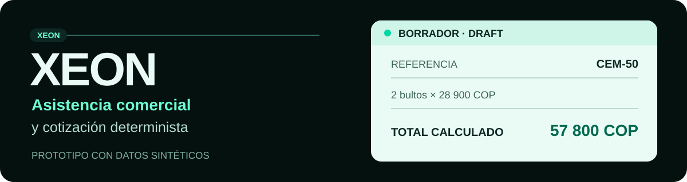
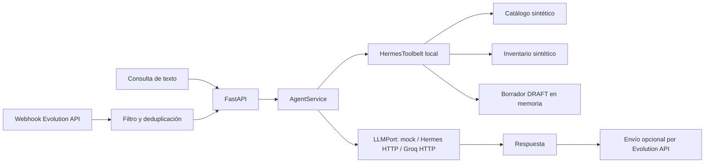

<p align="center">
  
</p>

# XEON — agente comercial para ferreterías

XEON recibe consultas sobre productos de ferretería y prepara **borradores de cotización**. Su
prototipo actual usa un catálogo y un inventario sintéticos en memoria: identifica referencias,
explica disponibilidad por sede y calcula importes con `Decimal`. La IA redacta la respuesta;
el backend conserva las reglas comerciales. El canal WhatsApp se integra mediante Evolution API,
pero requiere una instancia vinculada para operar con personas reales.

> [!IMPORTANT]
> **Estado actual: prototipo con datos ficticios.** No hay conexión al ERP de una empresa,
> persistencia comercial en PostgreSQL, aprobación humana ni PDF. Un borrador `DRAFT` no reserva
> inventario ni es una cotización aprobada.

| Disponible hoy | Límite actual |
|---|---|
| API FastAPI y CLI Typer | Sin autenticación ni aislamiento persistente entre empresas |
| Catálogo por SKU, alias y coincidencia de palabras en nombre, `specs` y descripción | Sin embeddings, `pgvector` ni RAG vectorial operativo |
| Stock sintético por sede con origen, vigencia y faltante local | Sin lectura ni reserva de inventario real |
| Borradores `DRAFT` con `Decimal` e idempotencia en memoria | Se pierden al reiniciar el proceso; sin aprobación ni PDF |
| LLM `mock`, conexión OpenAI compatible a Hermes local o Groq | `HermesToolbelt` es código propio; no hay un grafo de LangGraph |
| Webhook y adaptador de envío de Evolution API | La conexión real de WhatsApp depende de Docker, QR y configuración local |

**Ir directo a:** [primer uso](#4-guía-para-el-siguiente-desarrollador-instalación-desde-cero) ·
[comandos CLI](#6-herramienta-cli-actual-uv-run-xeon) ·
[estado y pendientes](#8-estado-del-corte-actual).

## Tabla de Contenidos

1. [Orden de Lectura Obligatorio (Fuente de Verdad)](#1-orden-de-lectura-obligatorio-fuente-de-verdad)
2. [Flujo de Trabajo del Proyecto (De Punta a Punta)](#2-flujo-de-trabajo-del-proyecto-de-punta-a-punta)
3. [Estructura del Repositorio y Fronteras Hexagonales](#3-estructura-del-repositorio-y-fronteras-hexagonales)
4. [Guía para el Siguiente Desarrollador (Instalación desde Cero)](#4-guía-para-el-siguiente-desarrollador-instalación-desde-cero)
5. [Cómo Testear Todas las Funcionalidades (4 Niveles de Prueba)](#5-cómo-testear-todas-las-funcionalidades-4-niveles-de-prueba)
6. [Herramienta CLI Actual (`uv run xeon`)](#6-herramienta-cli-actual-uv-run-xeon)
7. [Ideas de Evolución: Futura CLI y Flujo Copiloto con Gmail (Post-MVP)](#7-ideas-de-evolución-futura-cli-y-flujo-copiloto-con-gmail-post-mvp)
8. [Estado del Corte Actual](#8-estado-del-corte-actual)

---

## 1. Orden de Lectura Obligatorio (Fuente de Verdad)

Para cambiar código o reglas comerciales, leer en este orden:

| Orden | Documento | Función |
|---|---|---|
| 1 | [`XeonContexto.md`](XeonContexto.md) | Problema, historias de usuario, principios y alcance objetivo. Incluye funciones planeadas. |
| 2 | [`docs/ARCHITECTURE.md`](docs/ARCHITECTURE.md) | Fronteras de los módulos y trabajo pendiente. |
| 3 | [`CONTRIBUTING.md`](CONTRIBUTING.md) | Ramas, verificaciones y formato de commits. |

También están [`AGENTS.md`](AGENTS.md), con límites para agentes de código, y
[`GLOSSARY.md`](GLOSSARY.md), con términos del dominio.

**Criterio documental:** `XeonContexto.md` describe la visión del producto. En este README,
«implementado» significa que hay código y pruebas que lo respaldan. Si una especificación y el
código divergen, registrar la diferencia antes de ampliar la función.

---

## 2. Flujo de Trabajo del Proyecto (De Punta a Punta)

El recorrido de demostración comienza con una consulta de texto, pasa por el backend y termina
con una respuesta o un borrador. Puede entrar por `POST /v1/chat` o por el webhook de WhatsApp.



1. **Entrada.** La API recibe texto. En WhatsApp, el adaptador acepta eventos
   `messages.upsert`, ignora grupos, estados y ecos del propio bot, y deduplica hasta 1024 IDs
   por instancia **en memoria del proceso**. Con `WHATSAPP_REQUIRE_PREFIX=true`, exige `/xeon`
   o `#xeon`. El endpoint no verifica una firma del proveedor ni autentica al comprador.
2. **Contexto comercial.** `CommercialScopePolicy` permite cortesía, ayuda operativa y consultas de
   ferretería, construcción, agroferretería, plomería, electricidad y herramientas; los demás temas
   se bloquean antes del LLM. Después, `HermesToolbelt` busca referencias internas por coincidencia
   exacta o palabras de nombre, alias, `Product.specs` y `description_context`. Una coincidencia
   descriptiva solo produce opciones por nombre: el comprador debe elegir una antes de consultar
   stock o intentar crear un borrador de una línea.
3. **Reglas del backend.** `CreateQuoteDraft` solo acepta SKU o alias exactos, calcula con
   `Decimal`, rechaza descuentos sin política y guarda un `DRAFT` versión 1. La clave
   `(tenant_id, request_id)` evita duplicar ese borrador mientras viva el mismo proceso. Un
   producto ambiguo o medidas sin unidad deben aclararse antes de confirmar una referencia.
4. **Respuesta.** `AgentService` incorpora el contexto al prompt y llama al `LLMPort`. `mock`
   responde localmente; `hermes` y `groq` usan el adaptador HTTP OpenAI compatible. La clase
   `HermesToolbelt` no ejecuta por sí misma el ciclo de herramientas de Hermes: prepara contexto
   antes de la llamada al modelo. El envío por WhatsApp solo se intenta cuando
   `WHATSAPP_SEND_ENABLED=true`.

> [!NOTE]
> La confirmación conversacional se conserva en memoria por `conversation_id` o remitente de
> WhatsApp. El cliente responde por nombre o número de opción; los SKU y las etiquetas internas no
> se muestran. Solo una opción candidata desbloquea stock y borrador. El estado se pierde al
> reiniciar y aún no es persistencia empresarial. Los enlaces están bloqueados salvo registro
> explícito en `CustomerResponsePolicy`.

La vigencia `fresh`, `stale` o `unknown` se calcula sobre snapshots sintéticos y un instante
inyectado. Una fuente caída o un SKU desconocido no equivalen a «agotado». El webhook devuelve
`LOCAL_ONLY` cuando no está habilitado el envío; una respuesta `ACCEPTED_BY_PROVIDER` indica
aceptación por Evolution API, no entrega comprobada al teléfono.

---

## 3. Estructura del Repositorio y Fronteras Hexagonales

```text
src/xeon/
├── domain/                 Money, Product, Quote, StockSnapshot e invariantes
├── application/            Casos de uso y puertos (Protocol)
│   └── container.py        AppContainer: composición de adaptadores
├── agent/                  AgentService, prompt y HermesToolbelt local
├── adapters/
│   ├── catalog/            Catálogo sintético en memoria
│   ├── inventory/          Snapshots de stock en memoria
│   ├── persistence/        Borradores e idempotencia en memoria
│   ├── llm/                Mock y cliente HTTP OpenAI compatible
│   └── channels/           Parser y envío mediante Evolution API
├── api/                    Endpoints FastAPI y esquemas Pydantic
├── cli.py                  Cliente Typer de la API
└── config.py               Configuración tipada
scripts/                    Simulación y aprovisionamiento de Evolution API
tests/                      Pruebas de dominio, API, CLI y adaptadores
```

La arquitectura es **hexagonal, organizada por cortes verticales comerciales**: catálogo,
inventario, cotización y conversación tienen dominio o casos de uso, puertos y adaptadores. El
dominio no importa FastAPI ni HTTPX. `AppContainer` selecciona las implementaciones en memoria
y el proveedor LLM; FastAPI y Typer son interfaces de entrada.

**Tecnologías realmente instaladas en XEON:** Python 3.14.8, `uv`, FastAPI, Pydantic Settings,
Typer, HTTPX, Uvicorn, Ruff, mypy y Pytest. Docker empaqueta la API. El Compose opcional agrega
Evolution API, PostgreSQL y Redis para **la sesión de WhatsApp**; ese PostgreSQL no almacena aún
el catálogo, inventario ni las cotizaciones de XEON. SQLAlchemy, Alembic, pgvector y WeasyPrint
pertenecen al diseño futuro, no a las dependencias actuales de `pyproject.toml`.

---

## 4. Guía para el Siguiente Desarrollador (Instalación desde Cero)

### 4.1. Requisitos previos

- `uv` y acceso para instalar Python 3.14.8.
- PowerShell en Windows para los ejemplos siguientes; los comandos `uv` también funcionan en
  otras plataformas.
- Docker Compose solo para el canal WhatsApp; Hermes CLI solo para probar su puente local.

### 4.2. Primer uso: API y CLI en modo `mock`

Desde la raíz del repositorio, en la rama `developer/daniel` o una rama corta derivada:

```powershell
git branch --show-current
uv python install 3.14.8
uv sync --locked
$env:LLM_PROVIDER = "mock"
uv run uvicorn xeon.api.app:app --host 127.0.0.1 --port 8000
```

En otra terminal, desde la misma carpeta:

```powershell
uv run xeon health
uv run xeon chat "cemento"
uv run xeon quotes create --tenant-id demo --request-id demo-001 --line CEM-50:2
```

La última orden devuelve JSON con `outcome: draft_ready`, estado `DRAFT`, una línea y totales
calculados por el backend. Con el catálogo sintético actual, `CEM-50` cuesta `28900.00` COP por
bulto; dos bultos producen `57800.00` COP antes de descuentos. Ejecutar otra vez la orden con
el mismo `tenant_id` y `request_id` devuelve el mismo borrador con `replayed: true`, siempre
que la API no se haya reiniciado.

Para simular el webhook sin Docker ni teléfono:

```powershell
uv run python scripts/simulate_whatsapp_webhook.py --provider mock --message "/xeon necesito 2 bultos de cemento"
```

En modo `mock` no hay solicitudes al proveedor LLM. Es una demostración funcional local,
no una prueba de conexión con Groq, Hermes o WhatsApp real.

### 4.3. Perfiles de IA y canal opcional

| Perfil | Configuración | Efecto |
|---|---|---|
| `mock` | `$env:LLM_PROVIDER = "mock"` | Respuesta local; no consume créditos de inferencia. |
| `hermes` | `$env:LLM_PROVIDER = "hermes"` y servidor compatible en `HERMES_BASE_URL` | Envía chat al servicio HTTP local de Hermes; el modelo se selecciona con `HERMES_MODEL`. |
| `groq` | `$env:LLM_PROVIDER = "groq"` y `GROQ_API_KEY_FILE` | Hace solicitudes a Groq; pueden aplicar límites o costos del proveedor. |

`hermes` requiere que el servidor HTTP de Hermes esté realmente disponible en la URL configurada.
El comando y las opciones para iniciarlo dependen de la versión instalada de Hermes; comprobar
su ayuda local antes de usarlo. El puente no instala Hermes dentro del repositorio.

Para la prueba con Evolution API, revisar primero [`compose.evolution.yaml`](compose.evolution.yaml)
y configurar credenciales propias fuera de Git. Después:

```powershell
docker compose -f compose.yaml -f compose.evolution.yaml --profile core up -d --build
uv run python scripts/setup_evolution_whatsapp.py
```

El segundo comando configura una instancia de prueba y, si Evolution API devuelve un QR, lo
guarda como `qr_whatsapp.png` para vincular un teléfono. Por defecto, este perfil activa el
envío y exige el prefijo `/xeon` o `#xeon`. La recepción y entrega con un número real requieren
una prueba manual; la suite automatizada usa transportes simulados. Los servicios de terceros
pueden cambiar sus condiciones y límites de uso.

**Seguridad local:** no copiar claves en el README, prompts, capturas ni commits. Consulta
[`AGENTS.md`](AGENTS.md) y [`CONTRIBUTING.md`](CONTRIBUTING.md) para el manejo de secretos y
la revisión de cambios. Los valores de demostración del Compose no son credenciales de
producción. La API y el webhook carecen hoy de autenticación; limita su exposición a un
entorno local de pruebas.

---

## 5. Cómo Testear Todas las Funcionalidades (4 Niveles de Prueba)

### Nivel 1. Calidad y suite automatizada

```powershell
uv run ruff check .
uv run ruff format --check .
uv run mypy src
uv run pytest
```

Las pruebas cubren dominio monetario, ambigüedad de producto, cotización, stock, API, CLI,
adaptadores LLM y contrato del webhook. Usan `mock` o dobles HTTP; su aprobación no demuestra
una conexión real a Groq, Hermes ni WhatsApp. El número de pruebas puede cambiar en cada corte.

### Nivel 2. Demostración local sintética

Ejecuta los comandos de [4.2](#42-primer-uso-api-y-cli-en-modo-mock). Comprueba además
`uv run xeon stock show --sku CEM-50 --requested-branch-id sede-norte --requested-quantity 50 --evaluated-at 2026-10-08T15:00:00+00:00`.
La fecha es parte de los fixtures sintéticos para demostrar la clasificación de vigencia;
no representa el inventario del día actual.

### Nivel 3. Integración opcional con LLM externo

Selecciona `hermes` o `groq` según [4.3](#43-perfiles-de-ia-y-canal-opcional) y prueba
`uv run xeon chat "cemento"` con la API iniciada bajo ese perfil. Revisa la respuesta y los
errores HTTP del proveedor. Esta prueba puede consumir cuota de API.

### Nivel 4. Integración opcional con WhatsApp

Levanta el Compose, vincula el QR y envía desde un teléfono de prueba un mensaje que comience
por `/xeon`. Confirma en el chat real la respuesta y comprueba que un mensaje sin prefijo se
ignore. Esta verificación no está cubierta por el resultado de Pytest.

---

## 6. Herramienta CLI Actual (`uv run xeon`)

La CLI habla con la API HTTP. La API debe estar en `http://127.0.0.1:8000`, o debes pasar
`--base-url` al comando. No consulta los repositorios en memoria directamente.

| Comando | Función |
|---|---|
| `uv run xeon health` | Estado de la API y proveedor LLM activo, sin mostrar claves. |
| `uv run xeon chat "cemento"` | Un turno de conversación por `POST /v1/chat`. |
| `uv run xeon quotes create --tenant-id demo --request-id demo-001 --line CEM-50:2` | Crear o recuperar un `DRAFT`; repetir `--line` para varias referencias exactas. |
| `uv run xeon quotes show <UUID> --tenant-id demo` | Consultar el borrador existente en el mismo proceso. |
| `uv run xeon stock show --sku CEM-50 --requested-branch-id sede-norte --evaluated-at 2026-10-08T15:00:00+00:00 --requested-quantity 50` | Ver origen, tipo, vigencia y faltante del stock sintético. |

**Endpoints:** `GET /health`, `POST /v1/chat`, `POST /v1/quotes`,
`GET /v1/quotes/{quote_id}`, `GET /v1/stock` y
`POST /v1/channels/whatsapp/webhook`. FastAPI publica el contrato interactivo en
`http://127.0.0.1:8000/docs` cuando el servidor está activo. El detalle de entrada y salida
se define en [`src/xeon/api/schemas.py`](src/xeon/api/schemas.py).

Las cotizaciones explícitas no ejecutan el LLM. Si `--discount-requested` está presente,
la API devuelve `discount_policy_unavailable`, porque no existe una política aprobada. Una
consulta que no sea SKU o alias exacto no crea un borrador; puede devolver
`clarification_required` o `product_not_found`.

---

## 7. Ideas de Evolución: Futura CLI y Flujo Copiloto con Gmail (Post-MVP)

Esta sección describe **trabajo planeado**, sin comandos operativos todavía:

1. Persistir catálogo, stock y borradores de XEON en PostgreSQL 17 con esquema relacional,
   atributos `JSONB`, búsqueda vectorial `pgvector` y migraciones Alembic.
2. Aplicar políticas de descuento versionadas, aprobación humana por versión y generación
   de PDF de la cotización autorizada.
3. Enviar al trabajador una hoja de alistamiento multi-sede y una solicitud de confirmación
   por correo; solo tras aprobar la versión vigente, avisar al comprador por WhatsApp.
4. Extender la CLI con bandeja de borradores, diagnóstico de integraciones y acciones de
   aprobación sujetas a permisos.
5. Registrar productos ferreteros ausentes y notificar la necesidad a un trabajador mediante un
   puerto auditable. Esta capacidad no existe todavía y es distinta de la aprobación por Gmail.

Ninguna función de esta lista debe anunciarse como disponible en una demostración actual.

---

## 8. Estado del Corte Actual

| Área | Estado verificable | Falta para uso empresarial |
|---|---|---|
| Dominio y cotizador | `Money`, `Product`, `StockSnapshot`, `Quote` y casos de uso con pruebas. | Persistencia, concurrencia, precios y stock reales. |
| Búsqueda | Exacta, puntuación léxica y selección conversacional por nombre u opción, con códigos internos ocultos. | Índices JSONB, embeddings, pgvector y persistencia del estado conversacional. |
| IA | `AgentService`, `HermesToolbelt`, `LLMPort`, Mock y adaptador OpenAI compatible. | Validar el flujo real de Hermes/Groq y una orquestación de herramientas más controlada. |
| Arnés | Alcance determinista previo al LLM, separación básica de solicitudes mixtas y bloqueo de enlaces no registrados. | Catálogo administrable de categorías/enlaces y auditoría persistente de rechazos. |
| WhatsApp | Parser, webhook, filtro por prefijo, deduplicación local y adaptador de envío. | Autenticación del webhook, deduplicación persistente y prueba de entrega real. |
| Operación | CLI, API y Docker para entorno local. | Autenticación/autorización, auditoría, despliegue y monitoreo. |

Para contribuir, sigue el formato de commits `Type: :emoji: ActionInCamelCase` indicado en
[`CONTRIBUTING.md`](CONTRIBUTING.md) y ejecuta los cuatro controles del [nivel 1](#nivel-1-calidad-y-suite-automatizada).
