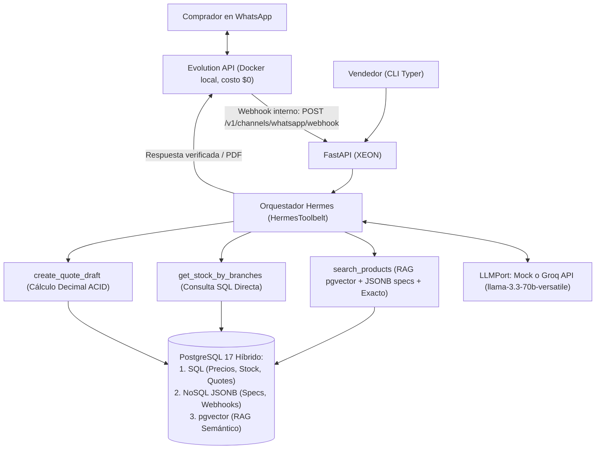

# XEON — Documento funcional, técnico y de trabajo del equipo

**Integrantes:** Daniel Mayorga y Juan Pablo Conde Zapata.  
**Fecha:** 17 de octubre de 2026.  
**Versión documental:** 2.0.  
**Estado:** especificación vigente; combina el núcleo ya implementado (Hermes, Groq, Evolution API, búsqueda híbrida y cotizador determinista) con las capacidades siguientes del proyecto.

Este documento establece qué construimos, qué problema resolvemos, cómo utilizamos las herramientas y qué condiciones debe cumplir cada entrega. El stack prioriza agilidad, costo \$0 en canales de mensajería mediante **Evolution API (WhatsApp)**, inferencia rápida con **Groq API**, orquestación con **Hermes** y una **base de datos híbrida empresarial (SQL Relacional + NoSQL `JSONB` + Vectorial `pgvector`)** sobre PostgreSQL 17.

## 1. Qué es XEON

XEON es un agente de inteligencia artificial especializado en asistencia comercial y elaboración de cotizaciones para ferreterías, agroferreterías y distribuidores. Conversa con el comprador por WhatsApp, identifica productos (incluso ante descripciones ambiguas o jerga ferretera), consulta datos empresariales verificados y prepara una cotización que pueda revisarse y enviarse sin reconstruir manualmente toda la información.

Su ventaja buscada es reducir el tiempo operativo del vendedor y mejorar la atención simultánea a clientes. Para lograrlo combina lenguaje natural y búsqueda semántica con consultas transaccionales verificables, cálculos programados (`Decimal`) y aprobación humana.

## 2. Problemática y usuarios

### 2.1. Problema observado

Preparar una cotización requiere mucho más que sumar precios. El vendedor debe identificar referencias, consultar cantidades por sede, revisar condiciones del cliente, evaluar descuentos, buscar productos faltantes y determinar cuándo podría entregarse cada material.

En el mostrador, esta labor consume el tiempo que también se necesita para atender a otros compradores. En ventas regionales o pedidos grandes, implica consultar varias fuentes y personas, con retrasos y riesgo de errores.

Según el caso aportado por Daniel, Ferragro cuenta con comerciantes en zonas como el Magdalena Medio que pueden atender al menos diez cotizaciones diarias, algunas de las cuales tardan horas. Se utiliza como contexto del problema; no equivale a un convenio con Ferragro, acceso autorizado a su sistema ni una medición independiente de su operación.

### 2.2. Personas para quienes se construye

| Usuario | Necesidad | Aporte esperado de XEON |
|---|---|---|
| Comprador particular | No siempre conoce el nombre o referencia | Preguntas aclaratorias y candidatos fundamentados. |
| Contratista o comprador empresarial | Cotizar varias líneas con condiciones particulares | Borrador consistente, disponibilidad por línea y entrega estimada. |
| Vendedor de mostrador | Atender clientes mientras prepara propuestas | Reducir búsqueda y digitación repetitiva. |
| Comerciante regional | Consultar otras sedes y abastecimiento | Consolidar información con origen y vigencia. |
| Supervisor comercial | Controlar descuentos y excepciones | Revisión por versión y trazabilidad de decisiones. |
| Administrador del negocio | Mantener catálogo y reglas coherentes | Importaciones validadas, permisos y auditoría. |

### 2.3. Ejemplos que orientan el diseño

- «Necesito el coso que va en el aire acondicionado»: solicitar función, equipo y características antes de seleccionar una referencia.
- «La pieza mide 20 × 30 × 10»: preguntar unidades, orientación y uso; esos números no determinan por sí solos diámetro, rosca o tolerancia.
- «Necesito 50 bultos de cemento y 300 metros de alambre»: consultar cada referencia y su unidad comercial; presentar fechas distintas cuando corresponda.
- «¿Hay una bomba de 1 HP en Barrancabermeja?»: consultar ubicación y stock, además de otros atributos necesarios para identificar la bomba.
- «Soy cliente frecuente, dame el descuento de siempre»: verificar la cuenta y consultar la política vigente; no aceptar el descuento solo por la afirmación del comprador.

## 3. Solución y alcance

### 3.1. Recorrido principal

El comprador envía su solicitud por WhatsApp. **Evolution API** entrega el evento a **XEON**, donde **Hermes** extrae la intención, busca referencias candidatas mediante búsqueda híbrida (**RAG semántico + atributos NoSQL `JSONB` + alias exactos**) y consulta las tablas relacionales de la base de datos para precios y stock. El backend calcula la propuesta y la guarda como borrador versionado (`DRAFT`). Un vendedor autorizado revisa, aprueba o corrige. El sistema genera el PDF aprobado y lo entrega por WhatsApp.

### 3.2. Incluido en el MVP

- Conversación en español por **WhatsApp mediante Evolution API** (autoalojada en Docker, sin costo por mensaje).
- Orquestación de herramientas comerciales con **Hermes** conectado a **Groq API**.
- Catálogo híbrido: unidades, alias, atributos técnicos polimórficos (`JSONB` / `specs`) y contexto semántico (`RAG` / `pgvector`) para identificar productos a partir de descripciones coloquiales.
- Inventario por sucursal/bodega con clasificación de vigencia (`fresh`, `stale`, `unknown`) y tipo (`local`, `transfer`, `delivery`).
- Precios, descuentos y logística calculados en el backend con `Decimal` y reglas explícitas.
- Borrador de cotización (`DRAFT`), revisión humana, versionado y generación de PDF.
- Operación interna por CLI (`Typer`), sin exigir un frontend pesado.
- Datos sintéticos verificados antes de conectar un ERP real.

### 3.3. Posterior al MVP

Panel web opcional (Jinja2 + HTMX), transcripción de audio/visión en WhatsApp, reservas reales en ERP, conversión automática a pedido y colas distribuidas si el volumen supera el procesamiento asíncrono local.

## 4. Principios obligatorios del producto

1. **La IA interpreta y desambigua; el backend decide y calcula.** El RAG y el LLM ayudan a identificar el `SKU` cuando el cliente habla con ambigüedad, pero los precios, descuentos y stock salen exclusivamente de consultas directas a la base de datos.
2. **Cada dato comercial tiene procedencia.** Guardar origen, momento de consulta y vigencia (`valid_until`).
3. **Desconocido no significa agotado.** Diferenciar ausencia de existencias, dato vencido (`stale`) y fuente caída.
4. **Avisar al trabajador de cotización confirmada.** Notificar cuando un borrador requiere o recibe aprobación.
5. **Ambigüedad exige aclaración.** Si hay varios candidatos semánticos o faltan medidas/unidades, preguntar antes de fijar un SKU.
6. **Una cotización no es una reserva.** No prometer bloqueo de stock si el sistema empresarial no lo ejecutó.
7. **La aprobación pertenece a una versión.** Cambiar una línea o condición invalida la aprobación anterior.
8. **Un reintento no debe repetir efectos evitables.** Deduplicar entrada (`external_message_id`) y borradores (`tenant_id + request_id`).
9. **El comprador no necesita una web.** Todo el flujo del cliente ocurre en WhatsApp.
10. **Los datos de demostración se identifican como ficticios.** Nunca atribuirlos a Ferragro.
11. **La intervención humana es funcionalidad del producto.**
12. **Cotización PDF.** La versión aprobada se entrega en formato PDF.

## 5. Stack tecnológico vigente (Simplificado y de Costo \$0)

| Capa | Tecnología | Para qué se usa |
|---|---|---|
| Lenguaje y Gestor | Python 3.14.8 + `uv` | Dominio, API, orquestador Hermes y CLI reproducible |
| API | FastAPI + Uvicorn + Pydantic 2 | Endpoints REST, recepción de webhooks y validación |
| Dominio | Python + `Decimal` | Cálculos monetarios exactos, stock y estados comerciales |
| Agente / Orquestador | **Hermes** (`HermesToolbelt`) | Ciclo de razonamiento y ejecución acotada de herramientas |
| Proveedor LLM | **Groq API** (`llama-3.3-70b-versatile`) + `MockLLM` | Inferencia de baja latencia vía `LLMPort` + `HTTPX` |
| Canal WhatsApp | **Evolution API** (Docker local) + `HTTPX` | Conexión y automatización de WhatsApp sin costo por mensaje |
| Base de Datos Híbrida | **PostgreSQL 17** (`SQL` + `JSONB` + `pgvector`) | Transacciones ACID (SQL), fichas polimórficas (NoSQL `JSONB`) y búsqueda semántica (RAG `pgvector`) en un solo motor |
| Acceso a Datos | SQLAlchemy 2 + psycopg 3 + Alembic | Repositorios transaccionales y migraciones |
| PDF | Jinja2 + WeasyPrint | Generación de cotización en PDF |
| Terminal Interna | Typer + HTTPX | CLI para operar, consultar stock y revisar borradores |
| Despliegue y Calidad | Docker Compose, Pytest, Ruff, mypy, GitHub Actions | Entorno reproducible y verificación continua |

## 6. Arquitectura del sistema

Se utiliza un monolito modular con arquitectura hexagonal: el dominio define lo que necesita mediante protocolos, y los adaptadores conectan **Evolution API (WhatsApp)**, **Groq API** y **PostgreSQL 17 Híbrido**. Como Evolution API y FastAPI corren en la misma red de Docker Compose, el webhook viaja por red interna sin requerir túneles públicos.



### 6.1. Responsabilidad por módulo

| Módulo | Responsabilidad | Qué no debe hacer |
|---|---|---|
| `domain` | Entidades, dinero (`Decimal`), unidades, vigencia de stock, estados | Importar FastAPI, Evolution API o el cliente HTTP de Groq. |
| `application` | Casos de uso (`CreateQuoteDraft`, `GetStockByBranches`) y puertos | Depender de un formato concreto de mensajería. |
| `agent` | Orquestador **Hermes** (`HermesToolbelt`), prompts y selección de herramientas | Calcular totales por texto ni emitir aprobaciones. |
| `adapters` | Conectores hacia Groq, Evolution API, memoria y PostgreSQL | Incorporar descuentos o reglas comerciales ocultas. |
| `api` | Endpoints HTTP (`/v1/chat`, `/v1/quotes`, `/v1/stock`, `/v1/channels/whatsapp/webhook`) | Duplicar la lógica de cotización. |
| `cli` | Operaciones humanas desde terminal (`uv run xeon ...`) | Saltarse las validaciones del dominio. |

## 7. Herramientas de Hermes y límites

| Función | Entrada principal | Resultado esperado | Regla |
|---|---|---|---|
| `search_products` | Texto del cliente, atributo o SKU | Candidatos por coincidencia exacta, atributos `JSONB` (`specs`) o contexto semántico (`RAG`), junto con el precio oficial leído de la BD | Si la entrada es ambigua o sin unidades, exige aclaración. |
| `get_stock_by_branches` | SKU, sede, instante de evaluación, cantidad | Disponibilidad local, faltante y alternativas con vigencia (`fresh`/`stale`/`unknown`) | Consulta directa en BD; no reserva ni promete stock vencido. |
| `create_quote_draft` | `tenant_id`, `request_id`, líneas (`query`, `quantity`) | Borrador `DRAFT` versión 1 idempotente calculado con `Decimal` | Nunca aprueba ni inventa porcentajes de descuento. |

## 8. Arquitectura de Base de Datos Híbrida Empresarial (SQL + NoSQL `JSONB` + RAG `pgvector`)

En una ferretería o agroferretería real, usar **solo SQL rígido** obliga a crear cientos de columnas nulas para atributos distintos (HP de una bomba, PSI de un tubo, calibre de un alambre), mientras que usar **solo NoSQL (ej. MongoDB)** debilita la integridad transaccional ACID de precios, stock y cotizaciones.

XEON resuelve esto adoptando un **modelo híbrido multi-modelo dentro de PostgreSQL 17**:

1. **Capa SQL Relacional (Exactitud comercial y financiera):**
   - Columnas estructuradas con tipos estrictos para `sku`, `name`, `unit`, `list_price NUMERIC(14,2)`, `currency`, `catalog_version`.
   - Tablas `stock_snapshots`, `quotes` y `quote_lines` con integridad referencial y llave única de idempotencia `(tenant_id, request_id)`.
2. **Capa NoSQL Documental con `JSONB` e índices `GIN` (Agilidad polimórfica):**
   - `products.specs JSONB`: almacena especificaciones técnicas variables según la familia del producto (`{"diametro": "1/2 pulgada", "presion_psi": "200"}` o `{"calibre": "14", "uso": "cercas ganaderas"}`).
   - `whatsapp_events.raw_payload JSONB`: almacena los payloads de webhooks de Evolution API sin requerir migraciones de esquema ante cambios del proveedor.
   - `discount_policies.rules JSONB`: almacena condiciones promocionales o alianzas (ej. *RindeMás*).
3. **Capa Vectorial / RAG Semántico con `pgvector` (Desambiguación de lenguaje natural):**
   - `products.description_context` y `products.embedding`: almacenan usos comunes, problemas que resuelve el material y jerga ferretera regional **sin quemar precios ni existencias en el texto del vector**.
   - Cuando el cliente hace una consulta ambigua en WhatsApp, Hermes recupera los `SKU`s candidatos por similitud semántica + filtro `JSONB` y obtiene el precio/stock vigente directamente de las columnas SQL en la misma operación.

## 9. Canal WhatsApp sin costo con Evolution API

- **Recepción:** Evolution API se conecta a la cuenta de WhatsApp de pruebas mediante código QR y reenvía los eventos `messages.upsert` al endpoint `POST /v1/channels/whatsapp/webhook`.
- **Filtrado seguro:** El adaptador ignora eventos de estado (`status@broadcast`), grupos (`@g.us`) y mensajes enviados por el propio bot (`fromMe=True`).
- **Respuesta:** Cuando `WHATSAPP_SEND_ENABLED=true`, XEON envía la respuesta generada por Hermes a `POST {EVOLUTION_API_URL}/message/sendText/{EVOLUTION_INSTANCE}` autenticándose con `EVOLUTION_API_KEY` / `EVOLUTION_API_KEY_FILE`.

## 10. Configuración de referencia (`.env.example`)

```dotenv
APP_ENV=development
DATA_MODE=synthetic
DEFAULT_TIMEZONE=America/Bogota

# Inicio sin gasto de inferencia; activar groq solo para pruebas deliberadas.
LLM_PROVIDER=mock
LLM_MODEL=llama-3.3-70b-versatile
LLM_BASE_URL=https://api.groq.com/openai/v1
LLM_MAX_OUTPUT_TOKENS=2048
LLM_TIMEOUT_SECONDS=120
AGENT_MAX_STEPS=6

GROQ_API_KEY=
GROQ_API_KEY_FILE=

# Canal WhatsApp sin costo mediante Evolution API
WHATSAPP_SEND_ENABLED=false
EVOLUTION_API_URL=http://evolution-api:8080
EVOLUTION_INSTANCE=xeon-ferreteria
EVOLUTION_API_KEY=
EVOLUTION_API_KEY_FILE=

LOG_LEVEL=INFO
```

## 11. Casos mínimos de verificación

| ID | Caso | Resultado esperado |
|---|---|---|
| T01 | SKU y cantidad válidos | Consulta fuente, calcula y crea borrador exacto (`DRAFT` v1). |
| T02 | «El coso del aire» | Pregunta por características; no inventa referencia. |
| T03 | Medidas sin unidades | Solicita unidades y contexto (`missing_units`). |
| T04 | Producto en otra sede | Identifica origen y distingue stock `local`, `transfer` y `delivery`. |
| T05 | Solo parte del pedido disponible | Explica faltante local y alternativas verificables. |
| T06 | Fuente caída | Indica imposibilidad de confirmar; no responde «agotado». |
| T07 | Snapshot vencido | Señala antigüedad (`stale`) y no promete disponibilidad firme. |
| T08 | Descuento no autorizado | Rechaza si no hay política; no inventa porcentaje. |
| T09 | Consulta descriptiva/coloquial | Hermes recupera candidatos por contexto semántico (RAG) y `specs` (`JSONB`) con precio oficial de BD. |
| T10 | Webhook Evolution API (`messages.upsert`) | Normaliza mensaje del cliente, ignora `fromMe=True` y responde con datos verificados. |
| T19 | Perfil `mock` | Cero llamadas externas a Groq. |
