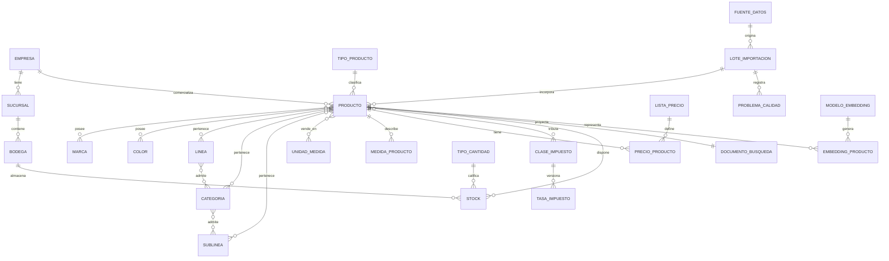
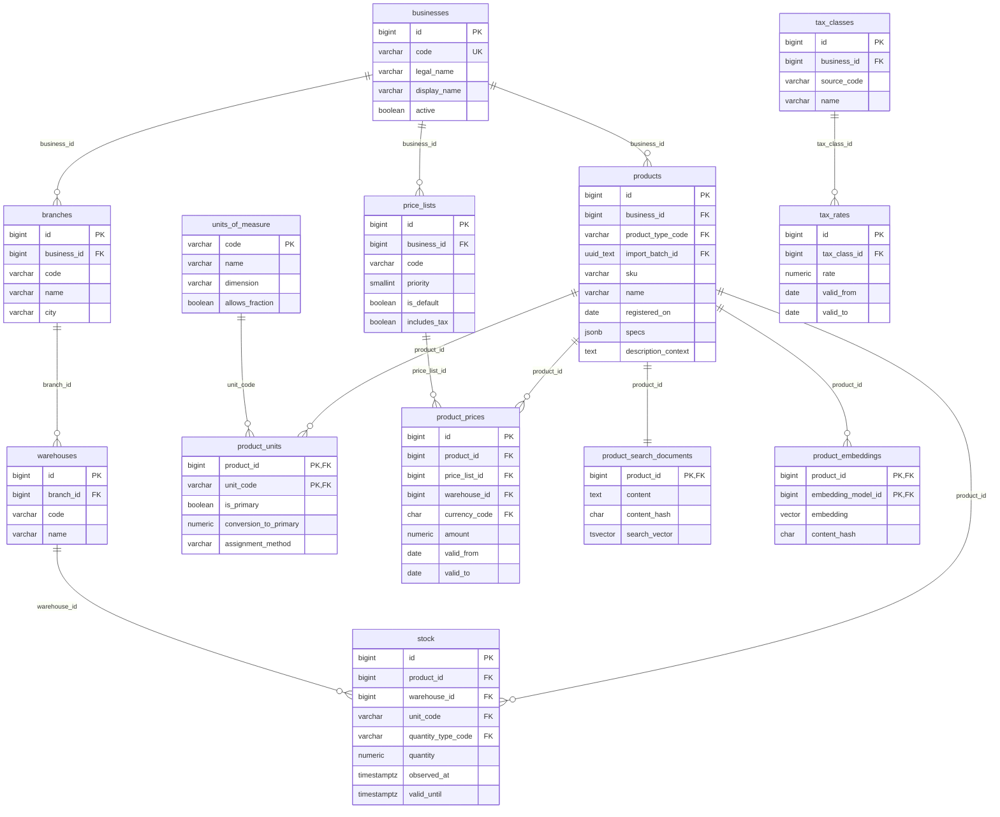

# Modelo de datos comercial

Este documento representa el esquema implementado por las migraciones de `commercial_migrations`.
La fuente comercial sanitizada pertenece a Ferretería El Campín. La base comercial permanece
separada del estado operativo, las conversaciones y las cotizaciones de XEON.

## Modelo E/R conceptual

El modelo conceptual muestra las entidades de negocio y sus cardinalidades, sin tipos físicos:

Decisiones principales:

- Una empresa admite múltiples sucursales y cada sucursal múltiples bodegas.
- Marca, color y las tres clasificaciones comerciales son relaciones independientes y
  multivaluadas; no se guardan como listas dentro de `products`.
- Precios, impuestos y stock tienen vigencia u observación temporal.
- Los documentos y embeddings sirven para recuperar candidatos; nunca son autoridad de precio o
  inventario.

## Modelo lógico normalizado

El esquema lógico usa claves sustitutas para entidades empresariales, claves naturales para
catálogos globales y tablas puente para dependencias multivaluadas:

La cuarta forma normal se conserva separando las asociaciones `product_brands`, `product_colors`,
`product_lines`, `product_categories`, `product_sublines`, `line_categories` y
`category_sublines`. `products.specs` es una proyección documental de atributos variables; las
medidas repetibles con semántica conocida se almacenan en `product_measurements`.

## Modelo físico PostgreSQL

El despliegue físico usa el esquema `commercial` y cinco revisiones Alembic:

| Revisión | Objetos principales | Controles físicos |
|---|---|---|
| `0001_commercial_core` | empresa, sucursal, bodega, fuentes, lotes y calidad | identidades `BIGINT`, FK con políticas de borrado, `JSONB` para detalle de calidad |
| `0002_normalized_catalog` | productos, unidades, marca, color y taxonomía | restricciones únicas compuestas, GIN sobre `specs`, índice por nombre, unidad primaria parcial |
| `0003_versioned_pricing` | moneda, impuestos, listas y precios | `NUMERIC(18,4)`, rangos de vigencia, lista predeterminada parcial, vista `current_product_prices` |
| `0004_normalized_stock` | tipos de cantidad y `stock` | `NUMERIC(18,3)`, observación/vigencia, vistas `available_stock` y `branch_stock` |
| `0005_vector_search_foundation` | texto completo, modelos y embeddings | `tsvector` generado + GIN, extensión `vector`, columna sin dimensión fija y sin índice ANN |

### Dominios y precisión

- Dinero: `NUMERIC(18,4)` y moneda ISO de tres caracteres; el agente convierte a `Decimal`.
- Cantidad: `NUMERIC(18,3)` para admitir unidades fraccionables.
- Tasas: `NUMERIC(7,4)` entre 0 y 100.
- Instantes: `TIMESTAMPTZ`; fechas de vigencia comercial: `DATE`.
- Atributos flexibles: `JSONB`; texto recuperable: `TSVECTOR` en configuración española.
- Vectores: tipo `vector` sin dimensión hasta seleccionar y versionar el modelo de embeddings.

### Vistas de consumo

- `current_product_prices`: elige el precio vigente por prioridad y lista predeterminada.
- `available_stock`: toma la observación más reciente de cada tipo y calcula disponibilidad sin
  permitir resultados negativos.
- `branch_stock`: agrega bodegas por sucursal.
- `catalog_products`: expone únicamente productos activos con unidad, precio vigente y documento de
  búsqueda; es la fuente del conector de solo lectura.

### Seguridad y operación

Las credenciales viven fuera de Git. El agente usa consultas `SELECT` parametrizadas y no recibe
permisos para aprobar cotizaciones, modificar inventario o ejecutar SQL libre. El esquema comercial
se migra con `alembic.commercial.ini` y no comparte historial con la persistencia operativa.

Revisión: 2026-10-31. Fuente de verdad física: `commercial_migrations/versions/`.
