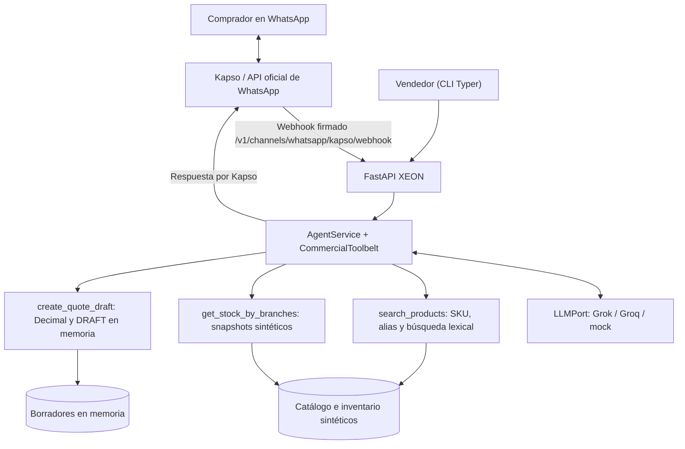

# XEON — Documento funcional, técnico y de trabajo del equipo

**Integrantes:** Daniel Mayorga y Juan Pablo Conde Zapata.  
**Fecha:** 17 de octubre de 2026.  
**Versión documental:** 2.0.  
**Estado:** especificación vigente; distingue el núcleo implementado (Kapso, Grok, Groq de respaldo, catálogo sintético y cotizador determinista) de las capacidades planeadas.

Este documento establece qué construimos, qué problema resolvemos, cómo utilizamos las herramientas y qué condiciones debe cumplir cada entrega. El canal WhatsApp usa **Kapso**; **Grok** es el motor predeterminado, **Groq** el respaldo y `mock` el perfil de pruebas. `AgentService` y `CommercialToolbelt` preparan el contexto comercial. La base híbrida empresarial (SQL relacional + `JSONB` + `pgvector`) sobre PostgreSQL 17 es una evolución planeada.

## 1. Qué es XEON

XEON es un agente de inteligencia artificial especializado en asistencia comercial y elaboración de cotizaciones para ferreterías, agroferreterías y distribuidores. Conversa con el comprador por WhatsApp, identifica productos (incluso ante descripciones ambiguas o jerga ferretera) y prepara un borrador calculado. El prototipo consulta datos sintéticos verificados; la integración con datos empresariales reales y la emisión de una cotización aprobada son posteriores.

Su ventaja buscada es reducir el tiempo operativo del vendedor y mejorar la atención simultánea a clientes. Hoy combina lenguaje natural, búsqueda lexical y cálculos programados (`Decimal`) sobre datos sintéticos; la búsqueda vectorial, las consultas transaccionales y la aprobación humana siguen planeadas.

## 2. Problemática y usuarios

### 2.1. Problema observado

Preparar una cotización requiere mucho más que sumar precios. El vendedor debe identificar referencias, consultar cantidades por sede, revisar condiciones del cliente, evaluar descuentos, buscar productos faltantes y determinar cuándo podría entregarse cada material.

En el mostrador, esta labor consume el tiempo que también se necesita para atender a otros compradores. En ventas regionales o pedidos grandes, implica consultar varias fuentes y personas, con retrasos y riesgo de errores.

Según el caso aportado por Daniel, Ferragro cuenta con comerciantes en zonas como el Magdalena Medio que pueden atender al menos diez cotizaciones diarias, algunas de las cuales tardan horas. Se utiliza como contexto del problema; no equivale a un convenio con Ferragro, acceso autorizado a su sistema ni una medición independiente de su operación.

### 2.2. Personas para quienes se construye

| Usuario | Necesidad | Aporte esperado de XEON |
|---|---|---|
| Comprador particular | No siempre conoce el nombre o referencia | Preguntas aclaratorias y candidatos fundamentados. |
| Contratista o comprador empresarial | Cotizar varias líneas con condiciones particulares | Borrador consistente, disponibilidad por línea y entrega estimada. |
| Vendedor de mostrador | Atender clientes mientras prepara propuestas | Reducir búsqueda y digitación repetitiva. |
| Comerciante regional | Consultar otras sedes y abastecimiento | Consolidar información con origen y vigencia. |
| Supervisor comercial | Controlar descuentos y excepciones | Revisión por versión y trazabilidad de decisiones. |
| Administrador del negocio | Mantener catálogo y reglas coherentes | Importaciones validadas, permisos y auditoría. |

### 2.3. Ejemplos que orientan el diseño

- «Necesito el coso que va en el aire acondicionado»: solicitar función, equipo y características antes de seleccionar una referencia.
- «La pieza mide 20 × 30 × 10»: preguntar unidades, orientación y uso; esos números no determinan por sí solos diámetro, rosca o tolerancia.
- «Necesito 50 bultos de cemento y 300 metros de alambre»: consultar cada referencia y su unidad comercial; presentar fechas distintas cuando corresponda.
- «¿Hay una bomba de 1 HP en Barrancabermeja?»: consultar ubicación y stock, además de otros atributos necesarios para identificar la bomba.
- «Soy cliente frecuente, dame el descuento de siempre»: verificar la cuenta y consultar la política vigente; no aceptar el descuento solo por la afirmación del comprador.

## 3. Solución y alcance

### 3.1. Recorrido principal

El comprador envía su solicitud por WhatsApp. **Kapso** entrega un webhook firmado a **XEON**. `AgentService` y `CommercialToolbelt` identifican referencias en el catálogo sintético, consultan snapshots de stock y calculan con el backend un borrador `DRAFT`. Grok redacta a partir del contexto verificado. La revisión humana, la persistencia empresarial y el PDF aprobado forman parte de la visión posterior.

### 3.2. Alcance objetivo del MVP

Los puntos siguientes describen el alcance buscado; las capacidades todavía no implementadas se señalan expresamente:

- Conversación en español por **WhatsApp mediante Kapso** y webhook firmado.
- Contexto comercial verificado por `AgentService` y `CommercialToolbelt`; **Grok** predeterminado, **Groq** de respaldo y `mock` en pruebas.
- Catálogo sintético en memoria con unidades, alias, `specs` y búsqueda lexical; `JSONB` y RAG vectorial con `pgvector` están planeados.
- Inventario por sucursal/bodega con clasificación de vigencia (`fresh`, `stale`, `unknown`) y tipo (`local`, `transfer`, `delivery`).
- Precios y borradores calculados en el backend con `Decimal`; la política de descuentos y la logística empresarial están planeadas.
- Borrador de cotización (`DRAFT`) versión 1; revisión humana, versionado de aprobaciones y generación de PDF planeados.
- Operación interna por CLI (`Typer`), sin exigir un frontend pesado.
- Datos sintéticos verificados antes de conectar un ERP real.

### 3.3. Posterior al MVP

- **Copiloto para el trabajador con confirmación por Gmail antes de facturar (planeado, no implementado):**
  - Cuando la cotización (`DRAFT`) con el cliente tiene definidos los productos, cantidades, sede de despacho y términos/descuentos internos del *harness*, el backend enviará un correo estructurado por **Gmail (SMTP)** al trabajador/vendedor esperando su confirmación antes de pasar a facturación (`PENDING_APPROVAL` → `APPROVED_FOR_BILLING`).
  - **Semáforo de descuentos en el Harness:** aplicación determinista de descuentos pre-aprobados por escala/volumen con `Decimal` y marcado de excepciones para autorización del supervisor humano en el correo.
  - **Hoja de alistamiento multi-sede (*Picking / Split-Order*):** inclusión automática en el correo del desglose de despacho por sede (retiro local vs. traslado entre bodegas) y tabla de SKUs lista para facturar en caja/POS.
  - **Confirmación humana de 1 clic y aviso al cliente:** al confirmar el trabajador desde el correo o CLI, se valida la versión del borrador y se notifica automáticamente por WhatsApp al cliente que puede pasar a facturar.
- Panel web opcional (Jinja2 + HTMX), transcripción de audio/visión en WhatsApp, reservas reales en ERP, conversión automática a pedido y colas distribuidas si el volumen supera el procesamiento asíncrono local.

## 4. Principios obligatorios del producto

1. **La IA interpreta y desambigua; el backend decide y calcula.** El RAG y el LLM ayudan a identificar el `SKU` cuando el cliente habla con ambigüedad, pero los precios, descuentos y stock salen exclusivamente de consultas directas a la base de datos.
2. **Cada dato comercial tiene procedencia.** Guardar origen, momento de consulta y vigencia (`valid_until`).
3. **Desconocido no significa agotado.** Diferenciar ausencia de existencias, dato vencido (`stale`) y fuente caída.
4. **Avisar al trabajador de cotización confirmada.** Notificar cuando un borrador requiere o recibe aprobación.
5. **Ambigüedad exige aclaración.** Si hay varios candidatos semánticos o faltan medidas/unidades, preguntar antes de fijar un SKU.
6. **Una cotización no es una reserva.** No prometer bloqueo de stock si el sistema empresarial no lo ejecutó.
7. **La aprobación pertenece a una versión.** Cambiar una línea o condición invalida la aprobación anterior.
8. **Un reintento no debe repetir efectos evitables.** Deduplicar entrada (`external_message_id`) y borradores (`tenant_id + request_id`).
9. **El comprador no necesita una web.** Todo el flujo del cliente ocurre en WhatsApp.
10. **Los datos de demostración se identifican como ficticios.** Nunca atribuirlos a Ferragro.
11. **La intervención humana es funcionalidad del producto.**
12. **Cotización PDF.** La versión aprobada se entrega en formato PDF.
13. **La respuesta al cliente respeta el alcance comercial.** Bloquear solicitudes ajenas a la ferretería antes de consultar el modelo y mantener la parte comercial de solicitudes mixtas.
14. **No exponer información interna.** Las respuestas de proveedores reales no deben revelar códigos internos, marcadores técnicos ni enlaces ajenos a los registrados.

## 5. Stack tecnológico vigente y planeado

| Capa | Tecnología | Para qué se usa |
|---|---|---|
| Lenguaje y Gestor | Python 3.14.8 + `uv` | Dominio, API, agente y CLI reproducible |
| API | FastAPI + Uvicorn + Pydantic 2 | Endpoints REST, recepción de webhooks y validación |
| Dominio | Python + `Decimal` | Cálculos monetarios exactos, stock y estados comerciales |
| Agente | `AgentService` + `CommercialToolbelt` | Prepara contexto verificado; el modelo redacta, el backend calcula |
| Proveedor LLM | Grok por defecto; Groq de respaldo; `MockLLM` en pruebas | Inferencia vía `LLMPort` + `HTTPX` |
| Canal WhatsApp | Kapso + `HTTPX` | Webhook firmado y envío por API oficial de WhatsApp vía Kapso |
| Base de datos híbrida (planeada) | PostgreSQL 17 (`SQL` + `JSONB` + `pgvector`) | Transacciones, fichas polimórficas y búsqueda vectorial |
| Acceso a datos (planeado) | SQLAlchemy 2 + psycopg 3 + Alembic | Repositorios transaccionales y migraciones |
| PDF (planeado) | Jinja2 + WeasyPrint | Generación de cotización aprobada |
| Terminal Interna | Typer + HTTPX | CLI para operar, consultar stock y revisar borradores |
| Despliegue y Calidad | Docker Compose, Pytest, Ruff, mypy, GitHub Actions | Entorno reproducible y verificación continua |

## 6. Arquitectura del sistema

Se utiliza un monolito modular con arquitectura hexagonal. Los adaptadores conectan **Kapso** y los proveedores LLM **Grok/Groq**; los datos comerciales del prototipo viven en memoria. PostgreSQL 17 híbrido es una evolución planeada. Kapso necesita una URL HTTPS pública para entregar el webhook al servidor local; durante el ensayo se usa un túnel `cloudflared`.



### 6.1. Responsabilidad por módulo

| Módulo | Responsabilidad | Qué no debe hacer |
|---|---|---|
| `domain` | Entidades, dinero (`Decimal`), unidades, vigencia de stock, estados | Importar FastAPI, Kapso o clientes HTTP de modelos. |
| `application` | Casos de uso (`CreateQuoteDraft`, `GetStockByBranches`) y puertos | Depender de un formato concreto de mensajería. |
| `agent` | `AgentService`, `CommercialToolbelt` y prompts | Calcular totales por texto ni emitir aprobaciones. |
| `adapters` | Conectores hacia Grok, Groq, Kapso y memoria; PostgreSQL queda planeado | Incorporar descuentos o reglas comerciales ocultas. |
| `api` | Endpoints HTTP (`/v1/chat`, `/v1/quotes`, `/v1/stock`, `/v1/channels/whatsapp/kapso/webhook`) | Duplicar la lógica de cotización. |
| `cli` | Operaciones humanas desde terminal (`uv run xeon ...`) | Saltarse las validaciones del dominio. |

## 7. Herramientas comerciales y límites

| Función | Entrada principal | Resultado esperado | Regla |
|---|---|---|---|
| `search_products` | Texto del cliente, atributo o SKU | Candidatos por coincidencia exacta y puntuación lexical de `specs` y descripciones; precio sintético del catálogo | Si la entrada es ambigua o sin unidades, exige aclaración. |
| `get_stock_by_branches` | SKU, sede, instante de evaluación, cantidad | Disponibilidad local, faltante y alternativas con vigencia (`fresh`/`stale`/`unknown`) | Usa snapshots sintéticos; no reserva ni promete stock vencido. |
| `create_quote_draft` | `tenant_id`, `request_id`, líneas (`query`, `quantity`) | Borrador `DRAFT` versión 1 idempotente calculado con `Decimal` | Nunca aprueba ni inventa porcentajes de descuento. |

## 8. Arquitectura de Base de Datos Híbrida Empresarial (SQL + NoSQL `JSONB` + RAG `pgvector`)

En una ferretería o agroferretería real, usar **solo SQL rígido** obliga a crear cientos de columnas nulas para atributos distintos (HP de una bomba, PSI de un tubo, calibre de un alambre), mientras que usar **solo NoSQL (ej. MongoDB)** debilita la integridad transaccional ACID de precios, stock y cotizaciones.

La arquitectura **planea** un modelo híbrido dentro de PostgreSQL 17. Las tablas, índices y flujos siguientes no están implementados en el prototipo:

1. **Capa SQL Relacional (Exactitud comercial y financiera):**
   - Columnas estructuradas con tipos estrictos para `sku`, `name`, `unit`, `list_price NUMERIC(14,2)`, `currency`, `catalog_version`.
   - Tablas `stock_snapshots`, `quotes` y `quote_lines` con integridad referencial y llave única de idempotencia `(tenant_id, request_id)`.
2. **Capa NoSQL Documental con `JSONB` e índices `GIN` (Agilidad polimórfica):**
   - `products.specs JSONB`: almacena especificaciones técnicas variables según la familia del producto (`{"diametro": "1/2 pulgada", "presion_psi": "200"}` o `{"calibre": "14", "uso": "cercas ganaderas"}`).
   - `whatsapp_events.raw_payload JSONB`: podría almacenar los payloads de webhooks de Kapso sin requerir migraciones de esquema ante cambios del proveedor.
   - `discount_policies.rules JSONB`: almacena condiciones promocionales o alianzas (ej. *RindeMás*).
3. **Capa Vectorial / RAG Semántico con `pgvector` (Desambiguación de lenguaje natural):**
   - `products.description_context` y `products.embedding`: almacenan usos comunes, problemas que resuelve el material y jerga ferretera regional **sin quemar precios ni existencias en el texto del vector**.
   - En una implementación futura, una consulta ambigua podría recuperar `SKU`s candidatos por similitud semántica y filtros `JSONB`; precio y stock vendrían de columnas SQL. Hoy la búsqueda es lexical sobre datos sintéticos en memoria.

## 9. Canal WhatsApp con Kapso

- **Recepción:** Kapso entrega eventos v2 `whatsapp.message.received` a `POST /v1/channels/whatsapp/kapso/webhook`. XEON comprueba `X-Webhook-Signature` con HMAC-SHA256 del cuerpo crudo antes de interpretar JSON; sin firma válida responde 401.
- **Filtrado y continuidad:** solo se procesan mensajes de texto entrantes, también en lotes. Se deduplican en memoria por ID externo; `conversation_key=kapso-{phone_number_id}-{phone}` mantiene el historial corto y `request_id=kapso-{message.id}` estabiliza la creación de borradores.
- **Respuesta:** cuando `WHATSAPP_SEND_ENABLED=true`, `KapsoChannelAdapter` envía texto por la API oficial de WhatsApp vía Kapso, autenticado con `X-API-Key`. Un acuse `processed` indica trabajo programado en segundo plano, no entrega confirmada al teléfono.
- **Operación:** el sandbox necesita `KAPSO_PHONE_NUMBER_ID`, `KAPSO_API_KEY` configurada a mano y URL pública por `cloudflared`. El registro del webhook deja el `secret_key` en `secrets/kapso_webhook_secret.txt`. No hay envíos proactivos ni plantillas fuera de la ventana de 24 h.

## 10. Configuración de referencia (`.env.example`)

```dotenv
APP_ENV=development
DATA_MODE=synthetic
DEFAULT_TIMEZONE=America/Bogota

# Grok por defecto; mock para pruebas sin red. Groq es respaldo.
LLM_PROVIDER=grok
LLM_MODEL=llama-3.3-70b-versatile
LLM_BASE_URL=https://api.groq.com/openai/v1
LLM_MAX_OUTPUT_TOKENS=2048
LLM_TIMEOUT_SECONDS=120
AGENT_MAX_STEPS=6

GROQ_API_KEY=
GROQ_API_KEY_FILE=

GROK_API_KEY=
GROK_API_KEY_FILE=secrets/grok_api_key.txt
GROK_MODEL=grok-4.6
GROK_BASE_URL=https://api.reto.pltk.mx/v1

# Kapso: clave manual y secreto de webhook en archivo ignorado por Git.
WHATSAPP_SEND_ENABLED=false
KAPSO_API_BASE_URL=https://api.kapso.ai
KAPSO_API_KEY=
KAPSO_API_KEY_FILE=
KAPSO_PHONE_NUMBER_ID=
KAPSO_WEBHOOK_SECRET=
KAPSO_WEBHOOK_SECRET_FILE=secrets/kapso_webhook_secret.txt
META_GRAPH_VERSION=v24.0

LOG_LEVEL=INFO
```

## 11. Casos mínimos de verificación

| ID | Caso | Resultado esperado |
|---|---|---|
| T01 | SKU y cantidad válidos | Consulta fuente, calcula y crea borrador exacto (`DRAFT` v1). |
| T02 | «El coso del aire» | Pregunta por características; no inventa referencia. |
| T03 | Medidas sin unidades | Solicita unidades y contexto (`missing_units`). |
| T04 | Producto en otra sede | Identifica origen y distingue stock `local`, `transfer` y `delivery`. |
| T05 | Solo parte del pedido disponible | Explica faltante local y alternativas verificables. |
| T06 | Fuente caída | Indica imposibilidad de confirmar; no responde «agotado». |
| T07 | Snapshot vencido | Señala antigüedad (`stale`) y no promete disponibilidad firme. |
| T08 | Descuento no autorizado | Rechaza si no hay política; no inventa porcentaje. |
| T09 | Consulta descriptiva/coloquial | `CommercialToolbelt` puntúa candidatos del catálogo sintético; RAG vectorial y BD empresarial siguen planeados. |
| T10 | Webhook Kapso firmado (`whatsapp.message.received`) | Verifica HMAC, ignora eventos ajenos y no texto, deduplica mensajes y programa la respuesta. |
| T19 | Perfil `mock` | Cero llamadas externas a proveedores LLM. |
