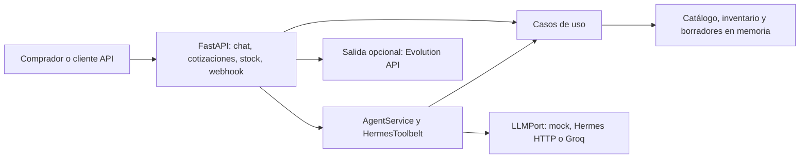

# Arquitectura actual

Revisado: 2026-10-24. XEON organiza API, agente, casos de uso, dominio y adaptadores mediante el [`AppContainer`](../../src/xeon/application/container.py). El contenedor construye catálogo, inventario y repositorio de borradores en memoria; elige el proveedor LLM según configuración y activa el canal de salida de WhatsApp solo si está habilitado.

El flujo de cotización crea un borrador y calcula en el dominio; el chat prepara contexto verificado con herramientas acotadas ([HermesToolbelt](../../src/xeon/agent/hermes.py), [caso de uso](../../src/xeon/application/quote_draft.py)). El webhook deduplica identificadores en memoria y devuelve `LOCAL_ONLY` si no hay canal de envío ([API](../../src/xeon/api/app.py), líneas 163-229).

**Frontera importante:** el lenguaje natural puede ayudar a encontrar un SKU; los importes y estados comerciales no deben depender del texto generado por el modelo ([arquitectura](../../docs/ARCHITECTURE.md), líneas 92-99). El almacenamiento SQL/JSONB/vectorial del [documento funcional](../../XeonContexto.md) pertenece a la evolución prevista, descrita en [estado del corte](estado-del-corte.md).

Áreas sin evidencia de implementación en esta revisión: autenticación de vendedores, persistencia empresarial, aprobación, PDF, integración ERP. Véase [decisiones pendientes](decisiones-pendientes.md).
