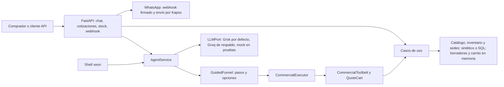

---
tags:
  - xeon/arquitectura
---

# Arquitectura actual

Revisado: 2026-10-26 (tras el merge `aa90b94` del embudo guiado). XEON organiza API, agente, casos de uso, dominio y adaptadores mediante el [`AppContainer`](../../src/xeon/application/container.py). Con `DATA_SOURCE=synthetic` (predeterminado) el contenedor construye catálogo, inventario y directorio de sedes en memoria; con `sql` los lee de la base de la ferretería mediante `connectors/<tenant>.yaml`. Además crea el repositorio de borradores y el carrito en memoria y las políticas desde `config/policies/`; elige el proveedor LLM según configuración y activa el canal de salida de WhatsApp solo si está habilitado.

El flujo de cotización crea un borrador y calcula en el dominio. En el chat, `AgentService` delega en `GuidedFunnel`, el único flujo (`GUIDED_FUNNEL_ENABLED`, `IntentInterpreter` y `CustomerResponsePolicy` se retiraron): cada paso ofrece opciones cerradas, Grok solo clasifica el texto libre de un paso cerrado y `CommercialExecutor` ejecuta las operaciones del carrito con herramientas acotadas ([CommercialToolbelt](../../src/xeon/agent/toolbelt.py), [caso de uso](../../src/xeon/application/quote_draft.py)) sobre un `QuoteCart` versionado; las cifras salen de plantillas deterministas y la salida pasa por `plain_text`, que da texto plano a API, CLI y Kapso ([servicio](../../src/xeon/agent/service.py), [ejecutor](../../src/xeon/agent/executor.py)). El webhook de Kapso verifica la firma HMAC, deduplica por `message.id`, responde de inmediato y procesa en segundo plano ([API](../../src/xeon/api/app.py), [adaptador](../../src/xeon/adapters/channels/kapso.py)). Revisado tras la limpieza D9 (2026-10-24): ya no existen Evolution API ni el proveedor Hermes.

**Frontera importante:** el lenguaje natural puede ayudar a encontrar un SKU; los importes y estados comerciales no deben depender del texto generado por el modelo ([arquitectura](../../docs/ARCHITECTURE.md), líneas 92-99). El almacenamiento SQL/JSONB/vectorial del [documento funcional](../../docs/XeonContexto.md) pertenece a la evolución prevista, descrita en [estado del corte](estado-del-corte.md); la recuperación vectorial sería una herramienta más de un agente con herramientas (D12, propuesta). El embudo guiado (D14) está **implementado**; la salida interactiva de Kapso (botones y listas) solo se verificó con documentación y dobles, y falta el sandbox real. El estado del embudo, el carrito y los borradores son locales al proceso.

Áreas sin evidencia de implementación en esta revisión: autenticación de vendedores, persistencia empresarial, aprobación, PDF, integración ERP. Véase [decisiones pendientes](decisiones-pendientes.md).

Grafo: [capa aplicacion](../graph/hub-aplicacion.md) · [mapa del proyecto](../graph/mapa-proyecto.md)
